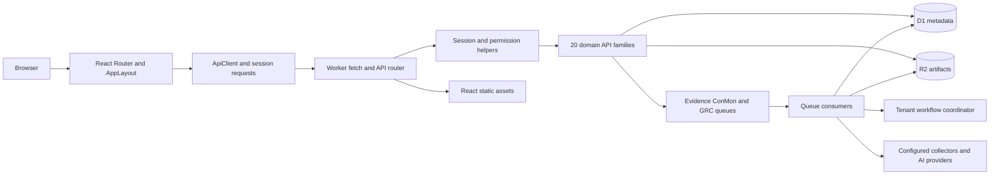

# Regovise architecture and UI/UX map

Reviewed 2026-10-11 (America/New_York), current working tree on `feature/origin-main`, HEAD `752f0ffe1` (`Implement Regovise Jira ticketing integration`). `git pull --ff-only` against configured upstream `origin/feature/origin-main` succeeded and reported already up to date. Existing uncommitted changes are part of this map and were preserved. This review did not establish what revision is deployed to the public domain.

## Start here

Regovise is a multi-tenant governance, risk, compliance, evidence, and assurance workspace. Its canonical app is React in `apps/web` plus the Cloudflare Worker in `cloudflare`. The Worker serves the React assets and API from one origin. It does not forward its normal domain requests to the Django backend. The documented canonical domain is `regovise.com` (and `www.regovise.com` in Worker configuration).

The product centers on reusable relationships: tenants contain domain folders and scoped people/roles; frameworks contain requirements; assessments review those requirements; applied controls and evidence explain implementation; risk registers/scenarios express exposure; findings, reviews, packages, tasks, and writebacks move remediation forward. Vendors, privacy processing, resilience studies, and portal assignments attach to the same workspace domains. Several imported/reference features have narrower behavior than their screen labels suggest.

The detailed maps are:

- [Frontend and core UX map](/Users/tkhan/IdeaProjects/ciso-assistant-community/.codex/maps/frontend-core.md): shell, login, navigation, design primitives, home, catalogues, assessments, risk, advanced risk, evidence, assurance, GRC, provider workflows, chat and ConMon. Includes route/page/form/action/API inventories.
- [Extended frontend and UX map](/Users/tkhan/IdeaProjects/ciso-assistant-community/.codex/maps/frontend-extended.md): every builder, AI surface, administration, people/access, integrations, vendors, privacy, resilience, reports, portal/imports, generic modules, compatibility bridges, and all Vanta prototype routes.
- [Cloudflare backend map](/Users/tkhan/IdeaProjects/ciso-assistant-community/.codex/maps/backend.md): all 20 API families, request lifecycle, storage and relationships, authorization, collectors, queues, Durable Objects, providers, service delivery, migrations/tables, source modules and endpoint selector inventory.
- [Repository reference tracks](/Users/tkhan/IdeaProjects/ciso-assistant-community/.codex/maps/repository-reference.md): purpose and request/data paths of Django/Svelte, CLI/MCP, automation/dispatcher, enterprise, openregscale, and imported content.
- [Local validation and screenshots](/Users/tkhan/IdeaProjects/ciso-assistant-community/.codex/maps/validation.md): what was tested locally, what failed, screenshots, and exact boundaries of the evidence.
- [Risks and implementation limits](/Users/tkhan/IdeaProjects/ciso-assistant-community/.codex/risks.md): prioritized findings with source links and proposed verification slices.

These maps provide a route- and subsystem-complete orientation to the current product. They are not a line-by-line audit of the entire monorepo, production validation, or proof of regulatory compliance.

## Runtime path

Boot starts at [main.tsx](/Users/tkhan/IdeaProjects/ciso-assistant-community/apps/web/src/main.tsx:7). `BrowserRouter` renders [AppLayout.tsx](/Users/tkhan/IdeaProjects/ciso-assistant-community/apps/web/src/shell/AppLayout.tsx:343). Session bootstrap checks `GET /_api/core/session` or exchanges the local demo identity for a cookie. The layout then reads `/iam/me`, derives access, and exposes the shell. Feature pages generally own React state and explicit loading/error/success messages; they call feature adapters or `ApiClient`, which sends JSON and cookies to `/_api`. No shared React Query/Redux cache is present.

Worker [index.ts](/Users/tkhan/IdeaProjects/ciso-assistant-community/cloudflare/src/index.ts:23) tries the separate `/api/service` gateway first, routes `/_api/*` through [router.ts](/Users/tkhan/IdeaProjects/ciso-assistant-community/cloudflare/src/router.ts:37), and otherwise serves assets with SPA fallback. The router splits the service prefix, resolves identity, dispatches handwritten service handlers, translates errors, and adds CORS. Handlers validate permissions, bind SQL to D1, write R2 artifacts, and enqueue work where needed. Successful data normally uses `{data: ...}`.

D1 is the business metadata source; R2 holds binary/JSON artifacts with keys referenced in D1. The 41 migration files define 169 distinct application table names. Two Durable Objects coordinate tenant workflow leases/run snapshots and separate service cases. Evidence, ConMon, and five GRC producer queues route jobs; a shared dead-letter queue records failed messages for administrative replay. The cron shown in configuration calls the service-delivery sweep; it is not a complete general-purpose ConMon scheduling engine.

Optional external services include AWS APIs, GitHub, Wiz, Okta, Jira, Mailchannels/webhook email, OIDC providers, Workers AI, OpenAI-compatible AI, SCF content endpoints, Vectorize and feature-gated Stripe donation checkout. Actual behavior depends on the particular path and configuration: some collectors use external fetch; Integration Manager Test/Sync records dry-run results; the general AI service often builds deterministic previews. Configuration labels alone do not prove provider execution.

## API service ownership

| Prefix under `/_api` | Principal responsibility |
| --- | --- |
| `core` | Initialization/login/session, frameworks and controls, risk registers/scenarios, perimeters, risk/compliance assessments, vendors/privacy/resilience, shared module catalog/records, overview and workflow snapshots |
| `iam` | Users, folders/domains, groups, roles, scoped assignments and effective access |
| `ops` | Advanced risk, imports, chat, portal, reports, tasks and operational control-room surfaces |
| `evidence`, `conmon` | Source collection, evidence metadata/artifacts/jobs, monitoring profiles and executions |
| `assurance`, `agent` | Evaluations, tracker imports, recommendations, human decisions, packages, workflow and bounded agent execution/writebacks |
| `grc` | Managed framework content/SCF, normalized findings, collectors, gap assessments, report bundles and scrutiny |
| `builders` | Forms/rules, questionnaire/assessment plans and responses, reports, dashboards, exports and wayfinder definitions |
| `ai` | Policy authoring, response automation, evidence mapping, RegML sessions and export options/jobs |
| `setup`, `integrations` | Saved administration settings, connector configuration and test/sync history |
| `trust-center`, `fedramp-communications`, `vdr`, `ccm`, `scn`, `secure-config`, `scope`, `crypto` | Provider offering trust/artifact/grant workflows and related FedRAMP operational registries |

The additional `/api/service` gateway is feature-gated, has case/artifact/cost/outbox/donation state, and currently has no corresponding canonical React workspace. Its donation status is deliberately independent of service eligibility.

## UI structure and navigation

The current shell has 13 information groups and 85 distinct navigation URLs in its source. Standard, admin, and internal audience labels plus actual permission predicates filter what each user sees. Route guards operate separately from backend permissions. Search aliases and preserved legacy paths expand discoverability beyond primary navigation.

| Group | Work users perform |
| --- | --- |
| Home | Program-health overview, search, analytics |
| Starter Guide | Admin onboarding and setup completion |
| Work Queue | My Access, tasks, findings, human review queue |
| Compliance | Program, frameworks/libraries, controls, assessments, policies and evidence packages |
| Risk | Risk registers/scenarios/actions, threat models, qualitative and quantitative studies, incidents/exceptions |
| Evidence and Assurance | Collect sources, inspect jobs/artifacts, evaluate evidence, reconcile tracker/package state, inspect agent runs |
| Vendors and Trust | Entities/contracts/solutions, questionnaire/portal follow-up and provider trust center |
| Assets and Systems | Assets/components/interconnections/supply-chain records and integrations |
| People and Access | People, groups, scoped roles, SSO/MFA/service-account configuration |
| Privacy and Resilience | Processing register, rights/breaches, business-impact analyses/recovery planning |
| Reports and Exports | Operational/DORA reports, report bundles, report builder and compliance exports |
| Automation and Builders | Chat, workflows/utilities and AI/form/rule/questionnaire/export/dashboard/wayfinder tools |
| Admin | Tenant settings, domains, classifications, modules, risk model, source/profile configuration and GRC administration |

The presentation is light with purple accents, white bordered cards, status pills, dense tables, drawers for authoring/inspection, and review dialogs for many consequential actions. `PagePrimitives` and Radix-based controls supply shared panels/forms/dialogs. Many list pages have explicit refresh and selection state rather than automatic polling.

At widths below 768px the shell uses a navigation drawer; 768–1279px uses a narrow rail; wider layouts expose the full sidebar, with optional collapse. The rail generally links only to the first item in each group, reducing secondary destination discoverability. Desktop tables often scroll internally. Mobile pages stack panels, but long lists/forms can be lengthy. Browser checks confirmed drawer open/close-button behavior and confirmed Escape does not dismiss it; source lacks modal focus trapping.

The Vanta area is a separate, hardcoded visual prototype selected before the normal workspace shell. Its 69 route declarations and local state are indexed in the extended map. It has no domain API persistence and should not be confused with the canonical Home/assessment screens.

## Major journeys, end to end

1. **Initialize and organize:** guarded first-workspace initialization establishes tenant/admin/session; administrators create domains, people/groups and scoped role assignments, select setup policy, install frameworks and complete quick-start steps. Login supports local passwords, email codes and OIDC; SAML/MFA/service-account screens have important enforcement limits detailed in the maps.
2. **Assess compliance:** choose domain/perimeter and framework, optionally reuse an assessment-plan template, create an assessment, review requirement statuses/scores/observations and evidence, generate applied controls/action plans, then inspect table/flash/Kanban presentations. Reference requirements and applied implementations are separate reusable objects.
3. **Manage risk:** create scoped risk register/scenarios, record likelihood/impact/inherent/residual exposure, create risk assessments and treatment views. EBIOS tracks workshop and scenario records; quantitative studies expose economics, assumptions and action views, but current retrigger behavior uses fixed multipliers rather than a full stochastic simulation.
4. **Collect and assure:** configured source → queued job → raw/normalized R2 bundle → findings/evaluation/explanation → tracker/recommendation → human review decision → package/export → optional bounded agent/writeback trace. URL query context connects the assurance workbenches. Approvals and artifacts are persistent server state, distinct from local drawer drafts.
5. **Analyze normalized GRC findings:** native collectors or supplied bundles feed normalized findings and control mappings; managed SCF/crosswalk content supports gap analysis; asynchronous jobs build evidence/report bundles and optional provider narratives. Scrutiny separately drafts questions, materializes Data Calls/evidence records, reconciles responses and records human sufficiency decisions.
6. **Oversee vendors and external responders:** maintain entity/solution/contract records; issue portal or questionnaire assignments; respondents save/submit scoped answers; workspace owners review progress and evidence references. The anonymous questionnaire frontend branch currently stalls because its route parameter is absent; authenticated rendering works through the matched route.
7. **Run privacy and continuity:** track processing and related data registers, rights requests and breaches; maintain BIA/recovery assumptions. Several child registers/threshold views are review-only in the current frontend.
8. **Build and report:** saved questionnaires/forms/rules drive assessments or response instances; reports and dashboards store definitions; export tools create jobs/files or semantic previews. File extension and “live preview” wording do not establish native DOCX/XLSX/OSCAL rendering or actual charts. Exact limits are documented per builder.

## Evidence and inventories

[Static route/API alignment](/Users/tkhan/IdeaProjects/ciso-assistant-community/.codex/maps/route-api-alignment.json) records 427 lexical API call sites, 156 normalized API path prefixes, 256 distinct frontend route patterns, 20 service families, 30 module routes and 50 semantic-contract routes; its declared gaps are zero. The checker collapses dynamic suffixes and checks metadata/source coverage. Its 138 E2E-route count comes from script source, not tests executed in this review.

[Route/component inventory](/Users/tkhan/IdeaProjects/ciso-assistant-community/.codex/maps/frontend-route-components.json) independently indexes 263 JSX Route declarations (including repeated/dynamic declarations), their page components, guards and source lines. [Canonical import graph](/Users/tkhan/IdeaProjects/ciso-assistant-community/.codex/maps/canonical-import-graph.json) indexes 268 canonical TS/TSX/JS/module files and 876 resolved local import edges. [Source inventory](/Users/tkhan/IdeaProjects/ciso-assistant-community/.codex/maps/source-index.csv) inventories application/reference source files and top-level declaration hints, excluding dependencies, generated locale files and data assets. These are mechanical indexes, not a verified runtime call graph.

The local runtime sweep exercised all 85 navigation URLs at 1440, 1024, 768 and 390 pixels (340 route-width checks), plus 23 seeded detail URLs, four create dialogs opened without submission, and four anonymous entry URLs. Two source-confirmed runtime defects were found: fresh demo bootstrap FK ordering and anonymous questionnaire permanent loading. Escape navigation behavior is also confirmed. See [Local validation and screenshots](/Users/tkhan/IdeaProjects/ciso-assistant-community/.codex/maps/validation.md) for restrictions and screenshots.

Both canonical typechecks, frontend build, IA/accessibility-token/import-UI checks, static alignment, 49 GRC fixture contracts and 103 sanitized framework documents, and queue-recovery contract verification passed. These results do not certify every mutation, external connector, regulatory export or production deployment.

## Deployment and operating boundaries

The production workflow deploys `apps/web` build through the Worker, with explicit production D1/R2/queue/DO/AI/Vectorize bindings. CI installs locked dependencies, typechecks/builds, validates a Wrangler package, syncs configured secrets, optionally applies migrations, deploys main, then runs production smoke and observable-parity preparation/verification. [deploy-regovise-edge.yml](/Users/tkhan/IdeaProjects/ciso-assistant-community/.github/workflows/deploy-regovise-edge.yml:1) is the exact workflow. A normal main push does not automatically apply new migrations; the manual workflow input controls that step.

Private configuration locations are documented by the repository: `cloudflare/.dev.vars`, `.env-prod`, `.env.production.local`, and CLI/MCP/dispatcher config files. Only their roles were mapped; their contents were not read. No deployment, production API, secret sync, auth change, remote migration or destructive database operation ran. Local UI used a newly created scratch database and a temporary config without private env files or remote bindings.

Follow-on changes should target the canonical stack. Legacy parity behavior and sandbox ideas need an explicit, bounded migration specification before implementation. The prioritized list is [Bounded follow-up candidates](/Users/tkhan/IdeaProjects/ciso-assistant-community/.codex/backlog.md); auth/access-control findings require explicit approval before changes.

## Proposed analyst/ISSO product direction

The [ATO workspace proposal](/Users/tkhan/IdeaProjects/ciso-assistant-community/documentation/design/regovise-ato-workspace-proposal.md) is a researched design target with seven daily areas, full operation/role/route preservation maps, visual concepts, capability gaps and bounded implementation slices. It is a proposal; the current runtime architecture and domain/persistence/authorization contracts above are unchanged.
