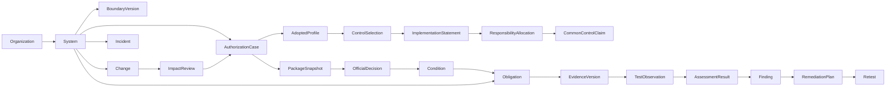

# Regovise ATO operations: requirements, lifecycle and backend gaps

Prepared 2026-10-11 (America/New_York). All web references below were accessed on this date. Audience: security analysts, ISSOs/ISSMs, system owners, control owners, assessors and authorizing officials. Working anchor: Federal NIST RMF plus FedRAMP provider/agency workflows, with agency/DoD profiles that must be confirmed before implementation. This is a design input and capability assessment, not an approved architecture, database migration or implementation. Only this document was created; application code, auth, persistence, credentials and production systems were not changed.

## 1. Product outcome and boundaries

Regovise should help an ISSO answer, for each system: what is authorized, under which scope and conditions, what has changed since the decision, which evidence is current, what work is due, what needs a human decision, and what package can be submitted or reused. Automation should collect, reconcile, test, suggest, track and prepare work; accountable people review claims and authorize consequential actions.

A control result, assessment progress percentage, evidence freshness score, package export and official authorization are different records. NIST's Authorize step places the risk decision with a senior official and uses a package containing plans, assessment reports, POA&M and executive context. The product must preserve that distinction. [NIST RMF Authorize](https://csrc.nist.gov/Projects/risk-management/about-rmf/authorize-step)

Recommended default workspace is **system operations with a portfolio view**. A tenant is the organization/customer; a domain folder is an access/organizational boundary; a system is the subject of authorization; an authorization case is a specific initial, ongoing, renewal, significant-change or retirement decision workflow. A cloud service offering and an agency system using it may be related but are not interchangeable.

Federal agencies still select, implement and assess their own responsibilities, review provider certification data, authorize their system, and monitor agency controls. Their SSP can identify controls as locally implemented or inherited from the provider. This makes an agency-consumer profile materially different from a cloud-provider certification profile. [FedRAMP Agency Responsibilities](https://www.fedramp.gov/2026/responsibilities/agencies/)

## 2. Policy facts that should shape the layout

These are source facts; product recommendations in later sections are proposed requirements derived from the user's goal and the current code, rather than claims that a government source mandates this particular UI.

- NIST SP 800-37 Rev. 2 defines seven stages, including **Prepare** before Categorize. The framework addresses security, privacy, common controls and ongoing authorization across the system lifecycle. [SP 800-37 Rev. 2](https://csrc.nist.gov/pubs/sp/800/37/r2/final), [RMF overview](https://csrc.nist.gov/projects/risk-management/about-rmf)
- FIPS 199 categorizes confidentiality, integrity and availability by potential impact. System impact values consider the maximum across resident information types for each objective. A label selected by an operator is not the same as an approved impact analysis. [FIPS 199](https://nvlpubs.nist.gov/nistpubs/FIPS/NIST.FIPS.199.pdf)
- SP 800-53 is the control catalog; SP 800-53B provides baselines/tailoring; SP 800-53A provides assessment methodology/procedures. NIST lists 5.2.0 minor releases of 800-53 and 800-53A dated August 27, 2025. Catalog revision, minor release, overlay and adopted baseline version should therefore be explicit. NIST cautions that crosswalks are not equivalent compliance decisions. [800-53](https://csrc.nist.gov/pubs/sp/800/53/r5/upd1/final), [800-53B](https://csrc.nist.gov/pubs/sp/800/53/b/upd1/final), [800-53A](https://csrc.nist.gov/pubs/sp/800/53/a/r5/final)
- FedRAMP's October 8, 2026 update confirms public 20x Class B/C pipelines opened at the end of August and says new legacy Rev5 applications stop processing June 11, 2027. The 20x page lists A/B/C available and D in future Phase 4. Do not present 20x as only a Low pilot or promise a generally available D track. Retain existing Rev5 cases and version the transition requirements. [FedRAMP October 8 update](https://www.fedramp.gov/2026-10-08-from-foundation-to-implementation/), [FedRAMP 20x](https://www.fedramp.gov/20x/)
- The 2026 rules have applicability by track, stakeholder, class and process. Their official machine-readable JSON repository is the structured source of truth; the rendered website is a reference. New rule imports should use stable rule identifiers and definitions, with reviewed version changes. [Using Consolidated Rules](https://www.fedramp.gov/2026/rules/), [Source Data](https://www.fedramp.gov/2026/sources/)
- The overall 2026 adoption timeline and per-ruleset deadlines differ. Optional early adoption began July 4, 2026; overall mandatory adoption is January 1, 2027, subject to specific effective dates. Rev5 VDR/VER, CCM, certification sharing and other rulesets have different transition/grace dates. The UI should show adopted policy and applicable effective dates instead of a single universal switch. [Overall timeline](https://www.fedramp.gov/2026/timeline/), [Rev5 ruleset deadlines](https://www.fedramp.gov/2026/providers/updating/deadlines/rev5/)
- A current 20x package is maintained certification data, including scope/overview, security decision record, KSIs, secure configuration guidance and ongoing information; agencies reuse it while documenting their own authorization decision. It is not a one-time static SSP folder or a substitute for agency-specific responsibility. [20x Certification Packages](https://www.fedramp.gov/2026/agencies/use/packages/20x/)
- The current Rev5 Security Decision Record requirements include rule handling, verification/validation, independent assessment, clarifications, artifacts and version/update/source metadata; Rev5 controls also carry parameters, implementation status and inheritance context. This is a separate rule/decision evidence concern from simply generating narrative text. [Security Decision Record](https://www.fedramp.gov/2026/providers/rev5/rules/security-decision-record/)

DoD/eMASS profile depth is intentionally unresolved. An official DISA historical fact-sheet search record describes package workflows, inheritance, control testing, POA&M and authorization tracking, but its direct PDF currently returned 404; the DoDI 8510.01 PDF and DCSA page returned 403 to this research tool. Do not infer a current universal eMASS API/import schema or DoD approval chain from that historical summary. Confirm the customer's governing instance, component policy, current user guide and authorized transport before building that profile. [DISA eMASS fact-sheet reference](https://www.disa.mil/~/media/files/disa/fact-sheets/emass.pdf), [DoDI 8510.01 official publication location](https://www.esd.whs.mil/Portals/54/Documents/DD/issuances/dodi/851001p.pdf)

## 3. Complete RMF lifecycle as operational work

NIST supplies the outcomes in the second column. The proposed product behavior is a design recommendation. These steps are revisited when scope, requirements, evidence or risk changes; they should not be a one-way percentage wizard.

| Stage | Source-supported outcome | Proposed ISSO/analyst work area | Exit/review evidence |
| --- | --- | --- | --- |
| Prepare | Identify roles, organizational risk strategy/tolerance, common controls and monitoring strategy. [Prepare](https://csrc.nist.gov/Projects/risk-management/about-rmf/prepare-step) | Register mission/system ownership; choose governing profile; define assessor/AO and control-owner assignments; list shared services and organization-provided controls; approve monitoring commitments. | Named owners/authority, applicable profile/version, scope candidate, risk context, responsibility gaps. |
| Categorize | Document system characteristics, impact categories and reviewed/approved categorization. [Categorize](https://csrc.nist.gov/Projects/risk-management/about-rmf/categorize-step) | Information-type inventory, CIA rationale, boundary/flows, privacy/CUI indicators, environment description, reviewer discussion and change impact. | Approved categorization version, rationale/source, approver, date and boundaries; unresolved data categories are visible. |
| Select | Select/tailor controls, designate common/hybrid/system-specific controls, allocate to components and develop system monitoring strategy. [Select](https://csrc.nist.gov/Projects/risk-management/about-rmf/select-step) | Adopt catalog/baseline/overlay; resolve organization-defined parameters; document exclusions/compensating choices; assign implementation responsibility and inherited segments. | Reviewed selected baseline and tailoring decisions, parameters, ownership and responsibility coverage. |
| Implement | Implement controls and update plans to reflect the actual implementation. [Implement](https://csrc.nist.gov/Projects/risk-management/about-rmf/implement-step) | Narrative editor, component/service responsibility, technical collection, policy/procedure evidence, evidence requests, implementation tasks and discrepancy queue. | Versioned as-built narrative, current proof, implementation gaps and responsible owner. |
| Assess | Approved assessment plan/team, conducted assessments, assessment reports, remediation and POA&M. [Assess](https://csrc.nist.gov/Projects/risk-management/about-rmf/assess-step) | Scope/plan and sampling; examine/interview/test tasks; objective results; observations and findings; assessor response threads; retest and remediation. | Plan approval, evidence-linked findings, assessor conclusion, SAR/result version and open-risk disposition. |
| Authorize | Risk determination/response and approval or denial using the authorization package. [Authorize](https://csrc.nist.gov/Projects/risk-management/about-rmf/authorize-step) | Freeze reviewed package, summarize residual risk, resolve conditions, present decision brief, record/import signed authority decision and package identifiers. | Official decision provenance, designated decision authority, conditions, scope/version and explicit term/review triggers. |
| Monitor | Monitor environment/controls, analyze/respond to outputs, report posture and support ongoing authorization. [Monitor](https://csrc.nist.gov/Projects/risk-management/about-rmf/monitor-step) | Today queue, connector/evidence health, changes, vulnerabilities/incidents, periodic tests, inherited-provider updates, expiring commitments and revised package review. | Completed obligations/evidence and review trail; changes/risk that require new review are linked to the existing authorization. |

Assessment task design should support specific determination statements, methods, objects and tailored depth/coverage. SP 800-53A describes examine, interview and test; a scan result alone cannot satisfy every method or objective. [SP 800-53A methodology, section 2.4](https://nvlpubs.nist.gov/nistpubs/SpecialPublications/NIST.SP.800-53Ar5.pdf)

## 4. Roles, delegated work and approval boundaries

NIST's role crosswalk reserves risk acceptance and signing the authorization decision to the AO; its designated representative may perform delegated coordination but not accept risk. The following operational permissions are proposed mappings that must be confirmed with each agency/customer rather than equated to today's tenant admin role. [NIST RMF roles crosswalk, pages 15–18](https://csrc.nist.gov/CSRC/media/Projects/risk-management/documents/Additional%20Resources/NIST%20RMF%20Roles%20and%20Responsibilities%20Crosswalk.pdf)

| Product role | Proposed work authority | Required separation |
| --- | --- | --- |
| Security analyst / control owner | Collect/reconcile assigned evidence; draft narratives; triage findings; implement assigned remediation; propose control mapping. | Cannot self-issue authorization, turn a proposed exception into accepted risk, or fabricate independent assessor sign-off. |
| ISSO / ISSM / system security lead | Own system work queue, coverage, package assembly, delegated reviews, monitoring and handoff preparation. | Package readiness/administrative handoff differs from final risk acceptance. |
| System owner / mission owner | Confirm system scope/mission/resources, implementation commitments and remediation ownership; sponsor decision package. | Ownership of system data does not imply AO authority. |
| Independent assessor / 3PAO where applicable | Review plan, perform/verify assigned tests, issue findings and assessor conclusions; clarify challenges. | Provider/control author edits cannot overwrite an assessor result; corrections retain provenance and reviewer intent. |
| AO / authorized decision official | Record actual risk acceptance/denial, authorization conditions and significant risk disposition for assigned systems. | Explicit authority, signed/attested decision and frozen package reference; no decision inferred from task completion. |
| AO representative / package reviewer | Review package, challenge claims, coordinate risk response and prepare decision brief. | Delegation scope stored; risk-acceptance signature remains with designated authority. |
| Common-control / cloud-service provider | Publish responsibility, scope, implementation/validation and maintained reusable evidence. | Inheritance is approved for its specific scope; consumer responsibilities remain unresolved until addressed. |
| Privacy / data owner / incident / change specialist | Review assigned information impacts, privacy duties, reportability, changes or operational tests. | Review/notification authority follows approved system profile, not global operator assumptions. |
| Tenant administrator | Manage organization accounts/configuration. | Administrative access must not automatically grant every system's approval or risk authority. |
| Automation worker / connector | Perform approved collection, normalization, repeatable tests, drafts and bounded dispatch. | Least-privilege capability, system/scope binding, trace, limits and human gate for consequential writes. |

Reviews should identify the assertion being approved, exact record/artifact version, approving role/scope, conflict/independence check, decision/justification, timestamps and any conditions. Revoked/departed access and delegated authority changes should stop pending consequential approvals. The existing source authorization issues in [risks.md](/Users/tkhan/IdeaProjects/ciso-assistant-community/.codex/risks.md) are prerequisites to trustworthy live analyst/AO workflows.

## 5. State design: official status, readiness and monitoring

Proposed UI/data distinctions:

1. **System lifecycle:** under development, operational, changing, retiring, decommissioned; sourced from system-owner records.
2. **Authorization case workflow:** draft, in preparation, review requested, changes requested, decision pending, decision recorded, superseded/withdrawn. These are workflow states, not government authorization outcomes.
3. **Official authorization decision:** exact decision type/status from the signed letter or authorized external system; authorizer, agency, decision date, effective/expiration dates only when provided, conditions, boundary/baseline/package version and source receipt. Unverified imported claims display “Decision verification pending.”
4. **Readiness:** required package elements complete, unreviewed evidence, unresolved conditions, assessment coverage, evidence quality and known risk. Expose counts/denominators/unknowns; an optional summary score cannot authorize or revoke a system.
5. **Monitoring health:** current/overdue/missing obligations, changed controls, stale evidence, scanner/log/connector gaps, unresolved incidents and provider changes. Failed evidence collection means health or confidence degradation; it does not automatically change the official letter to revoked.
6. **Provider certification/reuse:** external program designation/track/class/status and verified date, separate from the agency system's ATO/ATU or local policy decision.

Do not set a universal three-year expiration or guarantee that all authorizations expire. Proposed renewal handling uses actual decision terms, governing policy, events and customer-defined review commitments. Show “No expiration recorded” or “Ongoing authorization; review trigger …” when appropriate, with verification provenance.

For every material change the workspace should show **approved snapshot**, **current state**, **difference**, **affected controls/evidence**, **applicable review trigger**, and **owner**. This is the central maintenance workflow after authorization.

## 6. Current canonical backend capabilities and exact gaps

Classification is deliberately narrow: **implemented foundation** means the cited persistence/operation exists; **partial** means usable pieces exist but the complete ATO contract does not; **proposed/missing** means no complete canonical implementation was found in the current source. These are code-review results, not production test results. Existing mappings and full source inventories are in [backend.md](/Users/tkhan/IdeaProjects/ciso-assistant-community/.codex/maps/backend.md).

| ATO capability | Current status / source route and storage | Gap for the proposed product |
| --- | --- | --- |
| Organization and access | Implemented foundation: `/_api/iam/me`, folders/users/groups/roles/assignments; D1 IAM/folders and scoped permission helpers. [IAM](/Users/tkhan/IdeaProjects/ciso-assistant-community/cloudflare/src/services/iam/http.ts:1731), [authorization](/Users/tkhan/IdeaProjects/ciso-assistant-community/cloudflare/src/authorization.ts:194) | System-specific roles/delegation/independence and AO authority are absent; tenant-wide admin/scope flaws must be addressed separately. |
| System register / mission scope | Partial: `/_api/core/perimeters`; `/_api/core/modules/security-plans/records`; D1 `perimeters` and generic `module_records`. [perimeters](/Users/tkhan/IdeaProjects/ciso-assistant-community/cloudflare/src/services/core/http.ts:9434), [SSP schema](/Users/tkhan/IdeaProjects/ciso-assistant-community/cloudflare/src/services/core/moduleRegistry.ts:2098) | No single authoritative system identity binds all records, assessments, decisions and monitoring cases; SSP fields are editable JSON, not an authorization model. |
| RMF work tracking | Partial: `/_api/ops/rmf`, `/rmf/packages/:id/handoff`; `ops_rmf_packages` with JSON steps/artifacts/timeline. [RMF handler](/Users/tkhan/IdeaProjects/ciso-assistant-community/cloudflare/src/services/ops/http.ts:5446) | Current order omits Prepare; handoff advances/completes stages and marks Monitoring without AO decision, validated package or evidence gates. A staged wizard cannot be treated as ATO issuance. |
| Categorization / FIPS 199 | Partial: SSP generic CIA/overall/FIPS fields plus categorization utility description. [CIA fields](/Users/tkhan/IdeaProjects/ciso-assistant-community/cloudflare/src/services/core/moduleRegistry.ts:2139) | Information-type impact analysis, calculated high-water mark with review override rationale, policy/source version, categorization approval and change history are missing. |
| Catalog/versioned requirements | Implemented foundation: `/_api/core/frameworks`, import/system/file, controls/tree; `/_api/grc/frameworks` global knowledge, SCF crosswalks/content provenance. [imports](/Users/tkhan/IdeaProjects/ciso-assistant-community/cloudflare/src/services/core/http.ts:9093), [GRC](/Users/tkhan/IdeaProjects/ciso-assistant-community/cloudflare/src/services/grc-engine/http.ts:3182) | Tenant framework controls, GRC knowledge and selected ATO baseline are separate; need adopted profile/catalog release/overlay/selection provenance and update impact review. |
| Tailoring and parameters | Partial: shared security-profiles, questionnaires, policy-builder catalog queue/requirements; selected compliance control scope. [registry](/Users/tkhan/IdeaProjects/ciso-assistant-community/cloudflare/src/services/core/moduleRegistry.ts:2187), [policy finish](/Users/tkhan/IdeaProjects/ciso-assistant-community/cloudflare/src/services/ai/http.ts:1555) | Formal tailoring decisions, ODP assignments/selections, compensating controls, approved rationale and system-specific baseline versions are missing. |
| Control implementation narratives | Partial: generic security-control/security-plan records, requirement observations and RegML draft attempts. [control schema](/Users/tkhan/IdeaProjects/ciso-assistant-community/cloudflare/src/services/core/moduleRegistry.ts:2072), [RegML](/Users/tkhan/IdeaProjects/ciso-assistant-community/cloudflare/src/services/ai/regml.ts:1215) | Per-system/component/control statement versioning, owner-approved as-built narratives and effective dates are missing; RegML Apply only selects an attempt. |
| Common/hybrid/inherited controls | Partial: components and SSP inheritance summaries; trust-center services' customer responsibility arrays. [components](/Users/tkhan/IdeaProjects/ciso-assistant-community/cloudflare/src/services/core/moduleRegistry.ts:861), [provider service](/Users/tkhan/IdeaProjects/ciso-assistant-community/cloudflare/src/services/fedramp/runtime.ts:1416) | Need separately scoped provider/common-control claims, consumer duties, version/validity, owner review and impact propagation. A copied narrative cannot establish inherited satisfaction. |
| Assets/components / authoritative inventory | Partial: `/core/modules/assets/records`, `/components/records`; assurance declared/discovered slices; actual AWS inventory collector. [asset schema](/Users/tkhan/IdeaProjects/ciso-assistant-community/cloudflare/src/services/core/moduleRegistry.ts:89), [AWS collector](/Users/tkhan/IdeaProjects/ciso-assistant-community/cloudflare/src/services/assurance/awsLiveCollection.ts:854) | System/environment/region scope, stable asset identity, lifecycle/ownership, source conflict reconciliation and association to the approved boundary require explicit modeling. |
| Data flows/interconnections / third parties | Partial: generic interconnection/supply-chain/vendor records plus `/_api/scope/documents` provider resource flows and third parties. [interconnections](/Users/tkhan/IdeaProjects/ciso-assistant-community/cloudflare/src/services/core/moduleRegistry.ts:1182), [scope](/Users/tkhan/IdeaProjects/ciso-assistant-community/cloudflare/src/services/fedramp/http.ts:735) | Agreement/version/approval, counterpart system, transmission/data categories, shared responsibilities, connection review and approved boundary-change linkage are not complete. |
| Evidence ingestion and storage | Implemented foundation: `/_api/evidence/sources/:id/collect`, jobs/replay/artifacts; evidence queue → normalized assurance tables and R2 manifests. [evidence](/Users/tkhan/IdeaProjects/ciso-assistant-community/cloudflare/src/services/evidence/http.ts:95), [consumer](/Users/tkhan/IdeaProjects/ciso-assistant-community/cloudflare/src/queues/evidence.ts:29) | Scope/case/control-objective applicability, collection intent/credential owner, durable version history, expiration policy and evidence-owner sign-off are not uniformly system-scoped. |
| Provider automation | Partial: network GRC collectors GitHub/Wiz/Okta/AWS; AWS assurance collection; input-only normalizers elsewhere. [native collectors](/Users/tkhan/IdeaProjects/ciso-assistant-community/cloudflare/src/services/grc-engine/collectors.ts:836), [normalizer](/Users/tkhan/IdeaProjects/ciso-assistant-community/cloudflare/src/services/assurance/liveAdapters.ts:583) | Generic Integration Manager Test/Sync does not execute providers; absence of data/permission failures must yield unknown/error instead of healthy compliance. Additional integrations require verified contracts, not labels. |
| Evidence mapping / sufficiency | Partial: `/_api/ai/evidence-mapping` heuristic/vector metadata mapping and manual links; GRC scrutiny draft/materialize/reconcile/review. [mapping](/Users/tkhan/IdeaProjects/ciso-assistant-community/cloudflare/src/services/ai/evidenceMapping.ts:283), [scrutiny](/Users/tkhan/IdeaProjects/ciso-assistant-community/cloudflare/src/services/grc-engine/scrutiny.ts:1741) | Proposed mappings need explicit human adoption, system/objective/time scope and sufficiency decisions; materialized placeholders must not count as collected evidence. |
| SAP and assessment planning | Partial: reusable assessment-plan questionnaire templates, `compliance_assessment_plan_items`, assignment/recurrence metadata and review result rows. [plan seeding](/Users/tkhan/IdeaProjects/ciso-assistant-community/cloudflare/src/services/core/http.ts:3823), [builder](/Users/tkhan/IdeaProjects/ciso-assistant-community/cloudflare/src/services/builders/http.ts:2220) | Complete scope/methods/objects/sampling/assessor independence/schedule/prerequisites and approval record tied to a versioned SSP are missing. |
| 800-53A assessment execution | Partial: compliance per-control and plan-item result/notes; specific assurance deterministic evaluations. [review](/Users/tkhan/IdeaProjects/ciso-assistant-community/cloudflare/src/services/core/http.ts:11039), [eval engine](/Users/tkhan/IdeaProjects/ciso-assistant-community/cloudflare/src/services/assurance/runtime.ts:1682) | The ten assurance evaluations do not implement all 800-53A objectives, physical/personnel/privacy/administrative tests or independent assessor judgment. Need objective-level results and retests. |
| Findings / POA&M / risk disposition | Partial: `/_api/assurance/gaps`, `/poam` GET; `assurance_poam_items`; applied control follow-ups and generic issues/tasks/exceptions. [POA&M schema](/Users/tkhan/IdeaProjects/ciso-assistant-community/cloudflare/migrations/0030_assurance_foundation.sql:271), [generation](/Users/tkhan/IdeaProjects/ciso-assistant-community/cloudflare/src/services/assurance/runtime.ts:2122) | Typed lifecycle for milestones/owners/delay/risk disposition/retest/closure is incomplete; every generated due date currently defaults to 30 days irrespective governing policy. |
| Remediation / ticket writeback | Implemented foundation: approved Jira draft dispatch under `/_api/agent/writebacks/:id/dispatch-jira` and integration run traces. [Jira dispatch](/Users/tkhan/IdeaProjects/ciso-assistant-community/cloudflare/src/services/agent/http.ts:2350) | Need durable external receipt reconciliation, reopened findings, verified remediation/retest and controlled closure; dispatch success is not vulnerability closure. |
| SSP / SAP / SAR / POA&M export | Partial: AI export option/job metadata and text/custom XML; export builder semantic previews; assurance package produces real product-specific JSON/Markdown. [download](/Users/tkhan/IdeaProjects/ciso-assistant-community/cloudflare/src/services/ai/http.ts:732), [preview](/Users/tkhan/IdeaProjects/ciso-assistant-community/cloudflare/src/services/builders/exports.ts:1347), [actual package](/Users/tkhan/IdeaProjects/ciso-assistant-community/cloudflare/src/services/assurance/runtime.ts:4224) | Native Office renderers, schema-valid OSCAL models/FedRAMP rules data, complete document content, source-linked review and importer compatibility tests are missing. Filename/Ready state does not establish format validity. |
| Official AO decision and conditions | Proposed/missing: SSP has authorizer/status/date text/select fields; RMF progress is editable handoff state. [SSP status](/Users/tkhan/IdeaProjects/ciso-assistant-community/cloudflare/src/services/core/moduleRegistry.ts:2163), [handoff](/Users/tkhan/IdeaProjects/ciso-assistant-community/cloudflare/src/services/ops/http.ts:5504) | No authority-controlled decision record, signed letter/receipt validation, frozen package link, scoped conditions or authentic risk-acceptance gate found. |
| Renewal / reauthorization / retirement | Partial: generic ATO expiration/review/status and change fields; recurring assessment records. [dates](/Users/tkhan/IdeaProjects/ciso-assistant-community/cloudflare/src/services/core/moduleRegistry.ts:2137), [recurrence](/Users/tkhan/IdeaProjects/ciso-assistant-community/cloudflare/src/services/core/http.ts:4378) | Policy- and decision-driven trigger handling, official extension/review decisions, retirement closure and external status acknowledgement are missing. |
| Ongoing monitoring and obligations | Partial: `/_api/conmon/profiles/:id/run`, executions/metrics/reasonableness; tenant DO workflow tracking. [ConMon consumer](/Users/tkhan/IdeaProjects/ciso-assistant-community/cloudflare/src/queues/conmon.ts:49) | Latest evidence selection is tenant-wide; no full system-scoped obligations scheduler. Current cron only sweeps separate service delivery. [scheduled entry](/Users/tkhan/IdeaProjects/ciso-assistant-community/cloudflare/src/index.ts:74) |
| Periodic tests / annual assessments | Partial: manual/compliance assessments and templates; provider quarterly review/OAR records. | Full applicable test library, approved frequency, plan/retest/dependency/owner and due-generation engine is missing. “Annual” must be derived from selected obligation/profile, not applied to every control. |
| Vulnerability detection/evaluation/reporting | Partial: scanner findings and assurance evaluations; `/_api/vdr/sync`, reports/publication and vulnerability_evaluations. [VDR](/Users/tkhan/IdeaProjects/ciso-assistant-community/cloudflare/src/services/fedramp/http.ts:434) | Complete versioned VER/VDR rule handling, affected-resource linkage, exploitability/reachability, provider/agency impact, prioritization, exception/variance and validated closure are missing. |
| Significant change management | Partial: generic changes module + `/_api/scn/changes`, notice publication and stored due dates. [SCN](/Users/tkhan/IdeaProjects/ciso-assistant-community/cloudflare/src/services/fedramp/http.ts:598), [due logic](/Users/tkhan/IdeaProjects/ciso-assistant-community/cloudflare/src/services/fedramp/runtime.ts:2885) | Rule applicability, change-impact analysis and required reviewer decisions need system linkage. Current “business days” labels use calendar-day addDays, requiring a proper clock/calendar model. |
| Incidents and notifications | Partial: generic incidents + `/_api/fedramp-communications/incidents`, queue/manual channel confirmation. [incident handler](/Users/tkhan/IdeaProjects/ciso-assistant-community/cloudflare/src/services/fedramp/http.ts:379) | Severity/reportability determination, recipient-specific obligations, event clocks/updates/final report, provider receipt, acknowledgement and incident-to-control/authorization impact need complete implementation. |
| Common-provider certification / reuse | Partial: trust-center offering/service/artifact/grant model, scope/config/crypto/VDR/OAR shell. [provider runtime](/Users/tkhan/IdeaProjects/ciso-assistant-community/cloudflare/src/services/fedramp/runtime.ts:4578) | Current tenant offering defaults/JSON exports do not implement a complete current 2026 certification package. Consumer adoption, per-service compatibility, source status verification and provider update impact need a distinct workflow. |
| Trust-center/reviewer access | Implemented foundation with material security gap: public metadata, token grants, versioned R2 artifacts and access events. [grant](/Users/tkhan/IdeaProjects/ciso-assistant-community/cloudflare/src/services/fedramp/runtime.ts:1696), [artifact access](/Users/tkhan/IdeaProjects/ciso-assistant-community/cloudflare/src/services/fedramp/runtime.ts:5336) | Grant must be tied to artifact offering/tenant; implement approved confidentiality/scope/revocation and programmatic access contracts before claiming compatible sharing. |
| AI guidance and automation trace | Partial: tenant context, optional provider generation, deterministic fallbacks; assurance agent steps/policy decisions/writeback approvals. [AI provider](/Users/tkhan/IdeaProjects/ciso-assistant-community/cloudflare/src/services/grc-engine/aiBackend.ts:435), [agent run](/Users/tkhan/IdeaProjects/ciso-assistant-community/cloudflare/src/services/agent/http.ts:1347) | Need evidence-grounded proposed edits, quality/uncertainty/abstention, bounded scope/cost/time/dispatch and version review. Do not allow AI to create an official authorization decision. |
| eMASS/agency submission transport | Proposed/missing as interoperable integration: generic eMASS ID field and AI export catalog options only. [ID field](/Users/tkhan/IdeaProjects/ciso-assistant-community/cloudflare/src/services/core/moduleRegistry.ts:2180), [export options](/Users/tkhan/IdeaProjects/ciso-assistant-community/cloudflare/src/services/ai/http.ts:336) | No verified current instance schema/API, secure transport, reviewer approval, receipt, reimport/duplicate resolution or external decision synchronization. Start with an explicit handoff/export contract. |

## 7. Proposed logical records and relationships

The following names describe required **domain concepts**, not selected SQL table names or an approved public API. Existing tables may be extended/reused or new records may be introduced only after architecture review.

| Concept | Minimum proposed content and invariant |
| --- | --- |
| System | Stable ID, mission/owner, agency/organization, environment/boundary, security/privacy context, external registry IDs, access domains; references current approved and current working versions. |
| Authorization case | Purpose/track/profile, subject system/version, accountable team/reviewers, planned package, workflow states and official decision link; multiple cases over system life. |
| Profile/adoption | Issuer/source, version/hash, track/class/agency overlay, applicability answers, adopted effective dates, governing decisions and reviewed updates. |
| Categorization | Information types and CIA impacts/rationale, aggregate result, source assumptions, reviewer approval and boundary version. |
| Selected control / rule | Catalog/rule identifier/version, applicable/excluded/compensating decision, ODPs, common/hybrid/system-specific designation, responsible components and approved tailoring. |
| Implementation statement | Control/rule/component/owner scope, as-built narrative and mechanisms, version/effective date, proposed vs approved status, referenced proof and reviewer. |
| Common-control/inheritance claim | Provider/system/component, exact inherited portion, consumer duties, scope/version/validity, provider decision/evidence, local acceptance and changes. |
| Evidence version | Content/manifest/hash, origin/collector/actor, collection time and coverage interval, system/resources, claim/objective links, permissions/errors, quality/redaction/retention and reviewer disposition. |
| Test observation/result | Approved plan/objective/method/object, sampling/time, inputs/automation version, actual result/unknowns, evidence, assessor role and finding/retest links. |
| Finding/remediation | Weakness, affected resources/controls, risk rationale, source observations, accountable owner, milestones, planned/actual dates, exception/accepted risk if authorized, retest and closure evidence. |
| Package snapshot | Immutable selected source versions, document/model/template/schema versions, content hashes, completeness/validation results, approvals, redacted/shared variants and submission receipt. |
| Official decision | Provenance/authority, subject boundary/package, decision outcome, risk disposition, conditions, effective/expiration terms if present, verified external status and supersession. |
| Obligation | Source/profile/rule/condition/contract, trigger and applicability, schedule/clock, owner/reviewer, evidence expectation, execution/retry/remediation state and reviewed variance. |
| Change/incident | Observed vs approved details, affected system/control/provider, risk/reportability decisions, obligations, recipients/receipts, package/decision impact and closure. |

A mapping relationship should express its type and strength: “related to,” “supports evidence for,” “assessed under,” “inherits specified responsibility from,” and “accepted in decision” should remain distinguishable. Crosswalk relatedness alone does not prove that one control implementation satisfies another.

## 8. Obligation engine: complete suite without arbitrary calendars

The product needs a bounded set of **applicable** obligations per system, generated from a reviewed profile, actual authorization conditions and contracts. It should not manufacture deadlines for every catalog control or silently apply a uniform commercial cadence.

For every generated obligation record store:

- Stable source identifier and profile/version/hash; applicability explanation and adoption/transition state.
- Trigger: calendar recurrence, approved plan interval, new asset/scope, changed control/provider, vulnerability evaluation, incident/reportability, decision condition, explicit reviewer request or expiration term.
- Clock start event/time; elapsed versus business time; duration/unit/timezone; approved holiday/calendar/business-hours handling; pause/extension rules and who can approve them.
- Required output: test result, retained evidence, updated narrative, risk/impact assessment, reviewed package, notification or external confirmation.
- Owner, reviewer, independence/authority, dependencies, escalation threshold and evidence freshness criteria.
- Next scheduled run; execution trace; successful substantive completion versus merely queued/dispatched; receipts/acknowledgements; retry/deduplication/idempotency.
- Approved exception/variance and expiry/review trigger, with rationale and residual risk owner; unresolved conflict between governing sources visible to the ISSO.

Current FedRAMP VDR distinguishes vulnerability prioritization/timeframes using class, impact, internet reachability and exploitability. VER supplies evaluation/reporting context. A generic “high = 30 days” clock is insufficient. The exact applicability and rule force must be taken from the adopted profile rather than generalized from one example. [VDR](https://www.fedramp.gov/2026/providers/rev5/rules/vulnerability-detection-and-response/), [VER](https://www.fedramp.gov/2026/providers/rev5/rules/vulnerability-evaluation-and-reporting/)

Incident notification rules vary by class/impact and recipient-specific reporting procedures; change notifications distinguish change types and event-relative business-day timing. Proposed notification actions should display recipients, reportability decision, deadline basis and prepared content for authorized review. A record marked queued is not proof of delivery. [Incident Evaluation and Communication](https://www.fedramp.gov/2026/providers/rev5/rules/incident-evaluation-and-communication/), [Significant Change Notification](https://www.fedramp.gov/2026/providers/rev5/rules/significant-change-notification/)

Applicable independent assessments and collaborative review/reporting commitments belong in the same obligation view but remain separate from ordinary technical scans. Current Rev5 Class B/C IVV includes at-least-annual independent assessment requirements; selected controls and assessment scope depend on class/track. This is not a universal annual test of every control for every system. [Independent Verification and Validation](https://www.fedramp.gov/2026/providers/rev5/rules/independent-verification-and-validation/), [Collaborative Continuous Monitoring](https://www.fedramp.gov/2026/providers/rev5/rules/collaborative-continuous-monitoring/)

Proposed periodic program areas must include technical and nontechnical evidence where applicable: access/account/privilege review, training/personnel screening, vulnerability/penetration testing, configuration/assets/interconnections, incident exercise, contingency/restore exercises, logging/alert response, physical/environmental/media safeguards, privacy/data processing, supply-chain/acquisition/vendor reviews and document/control reassessment. This is a product coverage checklist; frequency, required test method, audience and success criteria come from the adopted control/profile/decision, not from this list.

## 9. Daily analyst and ISSO workflows

These proposed flows should be visible without switching to unrelated builder/admin modules.

### Today's work

A portfolio/system queue lists actionable obligations: due/overdue commitments, failed collectors, changes requiring impact review, newly discovered/unmatched assets, findings needing owners or retest, stale inherited claims, evidence requests, assessor challenges and decision conditions. Each item carries system, governing source, consequence, owner, due basis and next action. Separate operational signals from tasks awaiting human review. Unknown evidence is visible rather than painted green.

Suggested actions are bounded: review raw input/permission error; assign owner; request evidence; rerun approved collection; draft change impact; approve a scoped narrative version; schedule a planned test; prepare a notification; assemble package preview; request retest. Changing authority/acceptance requires the designated role and exact-version gate.

### Build an initial authorization package

Register system → capture scope/info types → review categorization → adopt/tailor baseline → allocate local/inherited duties → collect implementation proof → plan/approve assessment → record objective results/findings → prepare remediation/POA&M → render/validate package → reviewer changes → freeze snapshot → authorized submission → official receipt/decision import/record.

### Maintain an existing authorization

Start with the official decision and conditions. Compare today's boundary/implementations/providers to the approved snapshot. Run applicable monitoring obligations; route failures/findings; assess material changes; maintain narratives and tests; prepare current posture and periodic packages; ask for reauthorization/extension when the governing trigger requires it. Never “reissue ATO” automatically because all tasks look complete.

### Respond to a significant change

Capture proposal/event → map affected system/resources/flows/control responsibilities → compare adopted change policy → ISSO/owner impact review → plan tests/notifications/review → obtain applicable approval → implement through authorized external operations → verify result → update scope/control/evidence/package snapshot → record notifications/receipts → decide whether new authorization case is required.

### Close a vulnerability/finding

Retain source observation → dedupe/link affected assets/control → document risk/evaluation → assign owner/milestones → request or approve ticket writeback → receive actual remediation evidence → retest independently as required → reviewer closes or records authorized residual-risk disposition. Retain reopened/regressed results; closing the Jira ticket alone cannot close the assurance claim.

### Reuse a provider/common control

Identify provider/service and exact scope → verify source designation/decision/date → review current package/data/responsibility → select inherited portions → assign residual consumer duties → assess consumer configuration/integration → approve local applicability → subscribe to reviewed updates → surface drift/expired or changed claims → update system risk/decision context.

The current FedRAMP Minimum Assessment Scope rules address information resources, information flows/categories and relevant third parties. Proposed boundary tools should show included/excluded/supplemental resources and why, including impact of third-party information resources, instead of claiming every vendor is part of the certified offering. [Minimum Assessment Scope](https://www.fedramp.gov/2026/providers/rev5/rules/minimum-assessment-scope/)

## 10. Documents, models, export review and agency handoff

OSCAL provides separate implementation and assessment models. The implementation layer includes component definitions and SSP; the assessment layer includes plan, results and POA&M with system/plan context. Proposed internal records should preserve these relationships even when a selected customer requires Word/Excel instead. [OSCAL Implementation Layer](https://pages.nist.gov/OSCAL/learn/concepts/layer/implementation/), [OSCAL Assessment Layer](https://pages.nist.gov/OSCAL/learn/concepts/layer/assessment/)

| Artifact family | Proposed authoring/review contract | Current Regovise boundary |
| --- | --- | --- |
| System description/categorization/boundary/flows | Reviewed system version, information impacts, included resources, counterparties, diagrams and approval provenance. | SSP/scope JSON fields and generic asset/interconnection records are partial source data. |
| SSP/security/privacy plans | Selected/tailored controls and parameters, owner/common/hybrid responsibilities, as-built mechanisms, evidence and review state. | Generic security-plan/control records; AI export metadata does not produce a complete SSP. |
| SAP/assessment plan | Approved scope/objectives/methods/sampling/team/schedule tied to the SSP/baseline version. | Assessment-plan templates/items usable; no complete plan approval/model chain. |
| SAR/assessment results | Assessor observations/objectives/findings, evidence, conclusions, response and retest context. | Compliance review rows and deterministic assurance JSON/Markdown; complete official SAR renderer missing. |
| POA&M/remediation/risk disposition | Trace from finding to owner/milestones/status/authorized disposition and validated closure. | Generated POAM rows/action plans and Jira drafts; mature system-level lifecycle missing. |
| AO decision package | Frozen exact source set, executive risk brief, plans/reports/POAM, conditions and signature/receipt provenance. | Package JSON/manifests exist, official authority-controlled decision missing. |
| FedRAMP 2026 provider package/data | Adopted rule/class/track; overview/SDR/KSI scope/data/config/ongoing reports and independent review applicable to the profile. | Provider shell/working artifacts are partial; app-specific KSI/eval IDs are not official coverage certification. |
| Periodic monitoring/testing report | Source intervals, coverage/errors, trend/regressions, outstanding risks/conditions, reviewer and applicable report recipients. | ConMon/evaluation/OAR data available; policy-bound system scheduling/report integrity incomplete. |
| eMASS/agency import or other external handoff | Customer instance/template/schema version, export field mapping, validation, authorized dispatch, receipt and reconciled external record/status. | Catalog options and identifier fields only; interoperable connector/import verification missing. |

Every export should show: target format/profile version, included/excluded system/baseline scope, source snapshot/time, validator results, missing fields/unsupported semantics, redaction/sharing audience, reviewer approval, artifact hash, and actual transport status. “Draft preview,” “Validated file,” “Approved for submission,” “Submitted,” “Received” and “Accepted by authority” are different states.

For machine-readable exports require schema validation plus semantic/reference checks, and tests against the agreed receiving contract. For native documents require a real renderer and visual/parser validation; renaming text to `.docx` or `.xlsx` is unacceptable. Do not claim automatic eMASS/FedRAMP submission until the specific transport and external acknowledgement are implemented and authorized.

Certification sharing additionally requires accurate current/history/public/restricted content, agency/programmatic access and access logging applicable to the selected rule profile. These requirements inform the trust-center/reviewer area, but current grant scope security must be fixed before using that area for sensitive multi-system artifacts. [Certification Data Sharing](https://www.fedramp.gov/2026/providers/rev5/rules/certification-data-sharing/)

## 11. Safe automation and honest AI behavior

Proposed automation can:

- Refresh allowed system-scoped data, preserve raw input and emit explicit permission/coverage failures.
- Reconcile discovered resources and detect changes from the approved snapshot.
- Execute documented objective checks with test version, inputs and result evidence; identify unassessed/unknown objectives.
- Generate finite obligations from adopted rules and decision terms, calculate deadlines with the right clock, dedupe notifications and escalate actionable changes.
- Suggest control mappings, narrative/impact/remediation drafts and package deltas with evidence links and uncertainty.
- Prepare or execute approved external writebacks within the permitted connector/system/intent; capture actual receipts.

It should require explicit reviewed authority for baseline/tailoring adoption, accepting inherited responsibility, final assessment conclusions, exceptions/risk acceptance, package publication/submission and official decision recording. Frequency/recipient/content/case changes must remain reviewable when they materially change commitments.

A deterministic fallback is acceptable for preview guidance if labeled. It cannot manufacture fresh evidence, independent assessment, healthy provider status, signed decisions or complete government documents. Proposed AI results should identify source versions, extracted versus inferred statements, uncertainty/abstention, proposed patch diff, reviewers and whether anything was actually saved/dispatched. Domain writeback should be separately authorized from approving a draft suggestion.

## 12. Proposed capability boundaries and implementation acceptance

No service/table split is selected here. Candidate responsibilities for architecture review are system/case governance; versioned profile/control decisions; evidence/collection and objective results; findings/remediation; artifact/package/export validation; authority decisions/conditions; monitoring/obligations; and external handoff/access. Existing `core`, `assurance`, `agent`, `grc`, `evidence`, `conmon`, `builders`, `ops` and `fedramp` paths provide reusable foundations but currently cut across these concerns.

Before a target feature is labeled implemented, require observable acceptance such as:

| Contract | Proposed acceptance evidence |
| --- | --- |
| System/case scope | Two systems in one tenant, different domains and shared services retain separate cases/evidence/decision scope; authorized reuse is explicit. |
| Approved boundary/baseline | Version changes produce a delta, affected records and review requirements; imported framework update cannot silently rewrite an approved decision. |
| Authority | A general admin/analyst cannot create signed AO acceptance; delegated reviewer cannot accept risk; recorded decision cites exact package/authority. |
| Inheritance | Provider change/expiry creates review tasks for affected consumer responsibility allocations; local duties never disappear due to inherited narrative. |
| Evidence truth | Collection failure/permission absence/stale artifact remains unknown or failed; empty example data is excluded from evidence/readiness counts. |
| Assessments | Plan/objective/method/observations/results/retests preserve source versions and assessor independence; automated check covers only stated objectives. |
| Obligations | Effective dates/applicability/business calendars/trigger clocks/extensions are explainable; repeated sweeps do not duplicate task or notification; completion requires expected evidence. |
| POA&M | Finding→milestones→remediation→retest→review closure is traceable; policy deadlines are not replaced with blanket defaults. |
| Packages | Frozen approved sources hash/validate; invalid/native-placeholder exports are blocked; reviewer changes create new version rather than silently rewriting approved package. |
| External handoff | Approved exact artifact/intent, access scope, receipt/failure/retry, duplicate handling and verified external status are demonstrated in isolated tests. |
| Monitoring | Applicable obligations are system scoped; stale/changed state is visible alongside the original decision without fabricated revocation/renewal. |
| Trust center | Cross-system/tenant artifacts cannot be accessed with unrelated grant; expired/revoked grants fail; public/restricted versions and access evidence are accurate. |

Priority is to establish truthful system/case/state/decision and permission contracts, then connect existing evidence/control/assessment/remediation pieces, then implement policy-bound ongoing obligations and genuine exports/handoffs. A complete navigation/layout can expose all areas now with honest proposed/partial status; it must not pretend the backend already implements the new model.

## 13. Sources and unresolved profile choices

Primary sources were accessed 2026-10-11; no vendor claims or secondary articles were used for policy requirements. RFC/pilot materials were not treated as current binding rules where finalized 2026 pages supersede them. Exact customer-specific applicability, adoption, contract requirements and DoD component policy remain to be confirmed.

| Primary source | Use in this report |
| --- | --- |
| [NIST SP 800-37 Rev. 2](https://csrc.nist.gov/pubs/sp/800/37/r2/final) and linked RMF step pages | Lifecycle outcomes and separation of risk decision from work tracking. |
| [FIPS 199](https://nvlpubs.nist.gov/nistpubs/FIPS/NIST.FIPS.199.pdf) | CIA impact/categorization context. |
| [SP 800-53](https://csrc.nist.gov/pubs/sp/800/53/r5/upd1/final), [800-53B](https://csrc.nist.gov/pubs/sp/800/53/b/upd1/final), [800-53A](https://csrc.nist.gov/pubs/sp/800/53/a/r5/final) | Catalog/baseline/assessment differences, versions and scope. |
| [NIST RMF role crosswalk](https://csrc.nist.gov/CSRC/media/Projects/risk-management/documents/Additional%20Resources/NIST%20RMF%20Roles%20and%20Responsibilities%20Crosswalk.pdf) | Authority/delegation distinction. |
| [NIST OSCAL implementation](https://pages.nist.gov/OSCAL/learn/concepts/layer/implementation/) and [assessment](https://pages.nist.gov/OSCAL/learn/concepts/layer/assessment/) | Linked artifact model families. |
| [FedRAMP October 8 update](https://www.fedramp.gov/2026-10-08-from-foundation-to-implementation/), [20x](https://www.fedramp.gov/20x/), [timeline](https://www.fedramp.gov/2026/timeline/) | Current track availability and transition context; changes require future review. |
| [FedRAMP rules usage](https://www.fedramp.gov/2026/rules/) and [source data](https://www.fedramp.gov/2026/sources/) | Versioned applicability and official machine-readable source. |
| [Agency responsibilities](https://www.fedramp.gov/2026/responsibilities/agencies/) and [20x package reuse](https://www.fedramp.gov/2026/agencies/use/packages/20x/) | Provider versus agency decision scope. |
| [Rev5 deadlines](https://www.fedramp.gov/2026/providers/updating/deadlines/rev5/) | Distinct adoption/transition/grace periods. |
| [Minimum assessment scope](https://www.fedramp.gov/2026/providers/rev5/rules/minimum-assessment-scope/), [SDR](https://www.fedramp.gov/2026/providers/rev5/rules/security-decision-record/) | Scope and maintained rule/decision evidence. |
| [VDR](https://www.fedramp.gov/2026/providers/rev5/rules/vulnerability-detection-and-response/), [VER](https://www.fedramp.gov/2026/providers/rev5/rules/vulnerability-evaluation-and-reporting/), [IEC](https://www.fedramp.gov/2026/providers/rev5/rules/incident-evaluation-and-communication/), [SCN](https://www.fedramp.gov/2026/providers/rev5/rules/significant-change-notification/) | Profile-driven operational obligations and event clocks. |
| [IVV](https://www.fedramp.gov/2026/providers/rev5/rules/independent-verification-and-validation/), [CCM](https://www.fedramp.gov/2026/providers/rev5/rules/collaborative-continuous-monitoring/), [CDS](https://www.fedramp.gov/2026/providers/rev5/rules/certification-data-sharing/) | Independent assessment, collaborative monitoring and sharing responsibilities. |

Open decisions for the root design: provider versus agency primary persona; governing agency/DoD profile and permitted data; relationship between system and current perimeter/security-plan records; current official status transport; document/OSCAL/template versions; obligation adoption and accepted business calendar; who may act as AO in the product versus importing decisions from an external authority; and first implementation slice. These are not blockers to producing the full layout, but they are prerequisites to trustworthy backend implementation.
