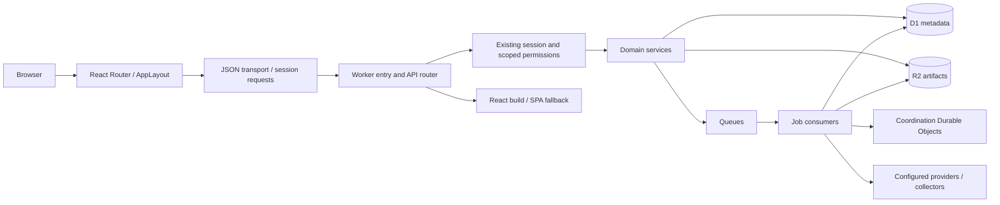

# Regovise architecture

Regovise is a multi-tenant governance, risk, compliance, evidence and assurance workspace. The canonical runtime is **React in `apps/web` plus Cloudflare Workers in `cloudflare`**. The Worker serves the React build and `/_api` from the same origin. It does not forward normal canonical domain requests to the legacy Django app.

This document describes existing ownership. The [analyst/ISSO workspace design](documentation/design/regovise-ato-workspace-proposal.md) proposes system and authorization-case workflows; those proposed contracts are not an implemented replacement for folders, perimeters, plans or provider offerings.

## Source ownership

| Path | Responsibility |
| --- | --- |
| `apps/web/src/main.tsx`, `shell/` | React entry, session/access boot, routes, role-filtered navigation and workspace chrome. |
| `apps/web/src/features/` | Feature-local pages, editors, forms, selections, API adapters and response types. |
| `apps/web/src/shared/api/`, `shared/session/` | JSON transport/error parsing and existing browser identity/session bootstrap. |
| `apps/web/src/components/`, `styles.css` | Shared Regovise/Radix UI primitives and visual tokens. |
| `cloudflare/src/index.ts`, `router.ts` | Worker fetch/queue/scheduled entry, API dispatch and SPA assets. |
| `cloudflare/src/services/` | Handwritten domain HTTP handlers and runtime services. |
| `cloudflare/src/durable-objects/`, `queues/` | Tenant workflow coordination, service coordination and job/dead-letter handling. |
| `cloudflare/migrations/` | Ordered D1 schema history; authoritative migration inventory. |
| `cloudflare/scripts/`, `apps/web/scripts/` | Existing workspace checks, fixtures and operating scripts. Local versus remote effect differs per command. |
| `ops/` | Root verification composition, source/reuse ratchets, source traceability, advisory audit and isolated local runtime runner. |
| `backend/`, `frontend/` | Legacy Django/Svelte parity source; independent manifests/tests. |
| `openregscale/`, `enterprise/`, `cli/` | Reference/workflow or separately owned tracks; not the canonical browser/Worker implementation. |
| `apps/web/prototypes/ato-workspace/` | Separately built synthetic UI preview; no production router/API/auth integration. |

## Request and data flow

`main.tsx` mounts React 18 and BrowserRouter. AppLayout establishes the existing cookie session, reads `/iam/me`, derives shell capabilities and renders guarded routes. Most feature pages own explicit loading/error/busy/draft state with React hooks; there is no central Redux/React Query store. Routes and menu visibility are separate from authoritative backend permissions.

ApiClient retains its current base URL, public verbs, JSON request serialization, cookies and local header-auth behavior. Its response helper reads text once, preserves valid JSON, returns undefined for empty 204/205, and raises typed HTTP/protocol errors. It does not validate every domain response, retry mutations or alter authentication.

The Worker routes `/_api/*` to services and other requests to assets with SPA fallback. A separate feature-gated `/api/service` gateway owns service-delivery cases; it is distinct from ordinary domain APIs. Domain APIs normally return `{data: ...}`; downloads and specialized operations have their own contract.

## Domain groups and stores

| API family | Principal responsibility |
| --- | --- |
| `core`, `iam` | Workspace initialization/session, domains/people/groups/roles, frameworks/requirements, perimeters, qualitative assessments/risk, vendors/privacy/BIA and shared module records. |
| `ops` | Reports, imports, chat, portal, advanced risk, tasks and operational projections. |
| `evidence`, `conmon` | Evidence sources/artifacts/jobs and monitoring profiles/executions. |
| `assurance`, `agent` | Deterministic evaluations, tracker imports, human recommendation decisions, packages, workflow traces and bounded writeback drafts. |
| `grc` | Managed catalogue/SCF content, normalized findings, native collectors, gap runs, reports and assessor scrutiny. |
| `builders`, `ai` | Form/rule/questionnaire/report/dashboard/export/wayfinder authoring and AI/profile/mapping/response/export workflows. |
| `setup`, `integrations` | Saved administrative configuration, connector metadata and lifecycle receipts. |
| Provider families | `trust-center`, communications, VDR, CCM/OAR, changes, secure configuration, scope and crypto registries. |

D1 owns metadata and relationships; R2 owns referenced evidence/package/report artifacts. Queues process evidence, ConMon and GRC jobs, with a shared dead-letter/recovery path. Durable Objects coordinate tenant workflow leases/snapshots and separate service cases. The existing cron is not a universal authorization-obligation or ConMon scheduler.

Native provider pathways and configuration-only/dry-run pathways coexist. Selected AWS/native GRC/SCF requests have a shared request-plus-consumption deadline. This is a per-operation deadline, not a guarantee that every provider, a multi-call collection or synchronous computation is globally bounded. Ordinary agent writeback approval remains separate from dedicated external dispatch. A completed job, generated package or RMF handoff is not an agency authorization decision.

## Verification ownership and evidence

[Root verification](ops/quality/README.md) composes current web/Worker checks without changing their dependency trees. [Isolated integration](ops/local/README.md) creates a temporary config/local D1/R2/queue state, uses synthetic fixtures, blocks outbound Worker HTTP and tears down its own process/state. Source policy scans canonical runtime boundaries; reuse policy ratchets reviewed exact-function clone debt. Neither proves domain semantics or production readiness.

Evidence should state its tier: source-declared → runnable test declared → executed synthetic/local test → actual isolated Worker/D1 readback → separately authorized external/production observation. Reports record revision and selected working-tree source fingerprint. A source-linked endpoint or past screenshot is not a current passing outcome.

## Operating and change boundaries

Follow [AGENTS.md](AGENTS.md). Preserve local uncommitted work. Do not read secret files, print environment contents, access production or run destructive database commands in ordinary development. Authentication, encryption, access control, audit behavior, public API/schema/persistence, dependency and architecture changes require their explicit scope/approval.

Offline release planning reads public Wrangler metadata and local migration inventory; it executes no deployment, secret synchronization, remote migration or target-history query. Real release scripts remain cloud-affecting operations, separately authorized. Configuration presence is not provider readiness.

The fuller source inventories and historical local observations are in [.codex/architecture.md](.codex/architecture.md), [.codex/maps/](.codex/maps/) and [the developer guide](documentation/engineering/developer-guide.md). Historical line references/defects must be checked against current code before another patch.
