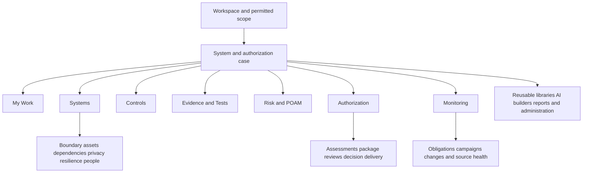

# Regovise analyst and ISSO workspace proposal

**Status: proposed product design, not an approved architecture change or implemented capability.** Prepared 2026-10-11 (America/New_York), using the current Regovise working-tree code map and public official reference documentation. The working assumption is Federal RMF and FedRAMP, with separate agency/DoD profiles; the user can refine the target. Existing product code, routes, persistence, permissions, dependencies and deployment are unchanged.

## Recommendation

Build Regovise around **the work, the system, and the authorization case**. The user should be able to answer: What needs my attention? Which boundary does it affect? What proves the implementation? What decision is still required? What changed since the last accepted package?

Use seven everyday navigation areas: **My Work, Systems, Controls, Evidence & Tests, Risk & POA&M, Authorization, Monitoring**. Keep the selected system and authorization case visible. Put specialist operations in local tabs and contextual tools. Simplify entry and navigation while preserving the full depth of each workflow.

Use Vanta's documented ownership/evidence clarity, RegScale's structured requirement-to-plan-to-assessment relationships, and Paramify's reusable implementation and contextual narrative ideas as design references. This is an inference from official public documentation, not a claim that their private products were tested or that copying any one interface completes the federal lifecycle. [Reference-product research and interaction contracts](/Users/tkhan/IdeaProjects/ciso-assistant-community/.codex/design/reference-products-and-interactions.md).

A single percentage or an RMF step-advance button must never establish an ATO. NIST's Authorize step requires a senior-official risk decision and an authorization package. Regovise should prepare, validate, coordinate and record that decision, including an externally issued decision; it should not manufacture it from completed tasks. [NIST Authorize step](https://csrc.nist.gov/projects/risk-management/about-rmf/authorize-step).

## Design ground rules

1. Every operating record/action shows its applicable scope, accountable owner and relevant version/window. Use explicit **System / Case**, **All accessible systems**, **Workspace / Shared**, **Multiple systems** or **Unlinked** labels as appropriate; reusable records show their system/case usage. Do not invent associations for library, administration or unlinked records.
2. Ordinary users see their work and permitted system areas. A role view changes emphasis, never permissions. A tenant administrator is not automatically an AO, assessor or risk-acceptance authority.
3. A requirement, its system implementation, evidence, assessment result and authorization decision remain distinct. Inheritance is a responsibility/provenance relationship, not a synonym for compliant.
4. Full capability is available through task context, local tabs, search and workspace tools. Hiding a primary menu item must not make an operation unreachable.
5. Every result can explain source, scope, observation period, evaluator version and review status. Unknown/missing/stale coverage stays visible.
6. AI prepares cited drafts, proposed mappings and summaries. It does not approve narratives, accept risk, close remediation without verification or grant authorization.
7. Configuration, simulation, preview and genuine execution are explicitly different states. An advertised export format requires a real valid artifact.
8. Rules have a program, version, applicability, effective period and policy source. Due dates have a trigger and a calendar definition. No universal cadence, severity clock or ATO expiry is assumed.
9. One authoritative record can appear in several views; closing a tab or completing a task does not silently create a second business truth.
10. Current uncommitted work is preserved. New system/case/snapshot and authorization contracts need review before implementation.

## Information architecture

This diagram is a proposed product navigation model, not a new backend service topology.

| Everyday area | First screen and primary action | Local tabs / full operations |
| --- | --- | --- |
| **My Work** | Prioritized assigned/review/overdue/blocked work; resume the highest useful action. | Assigned to me, Needs my review, Due soon, Blocked, Team work if permitted. Saved views with explicit system/case scope. |
| **Systems** | Permitted system portfolio with owner, program, recorded decision, next obligation and blockers; open/create a system. | Selected system: Overview, Boundary, Assets & Components, Dependencies, People; contextual Privacy, Resilience, Agreements, Activity. CSO offerings and agency systems are distinct linked records. |
| **Controls** | Selected baseline/control set with owner, implementation, evidence and assessment columns; resolve a control. | Area-level: Control set, Policies and contextual Libraries / reusable capabilities / tailoring. A selected control has Implementation, Parameters, Inheritance, Evidence, Assessment and History sections. Source catalogues remain distinct from implementation truth. |
| **Evidence & Tests** | Evidence requiring review and checks needing attention; review evidence or run a configured check. | Evidence, Automated tests, Requests, Collection runs, Sources. Manual review and assessment links remain visible. Actual files, observation windows and population coverage can be inspected. |
| **Risk & POA&M** | Overdue/high-impact findings and remediation; assign/verify the next remediation. | Findings, Vulnerabilities, POA&Ms, Risk register, Exceptions & acceptance, Changes, Incidents. EBIOS/quantitative tools open from the appropriate risk context. |
| **Authorization** | Current case stage, concrete blockers and reviewed package; continue assessment/package review. | Overview, Assessments, SSP & supporting documents, Package, Reviews, Decision, Delivery & responses, History. SAP/SAR and assessor data calls live under the assessment path. |
| **Monitoring** | Upcoming obligations, failed/stale checks and changes affecting the accepted posture; resolve the next obligation. | Obligations & calendar, Campaigns, Feed health, Change impact, Periodic reports, History. This view links source findings/changes/incidents rather than creating duplicates. |

**Tools** offers Libraries & reusable capabilities, AI authoring, Forms & questionnaires, Report/dashboard/export builders, Import/export utilities, Advanced risk, Automation recipes and role-permitted specialist workspaces. **Administration** contains people/roles/domain scope, authentication policies, classifications/tags, source/provider credentials, program configuration and operational health. These stay searchable and available in context. They do not add more competing everyday navigation groups.

The system selector supports a permission-filtered portfolio and an explicit all-accessible-systems lens. The authorization-case selector distinguishes agency/program, cycle/use case, profile/version and current versus historical package. Changing either preserves the original draft or asks to save/discard it; it cannot retarget a draft silently. Workspace/tenant switching remains separate from system switching.

## Role-based landing and work

| Role | Default entry | Typical work | Human boundary |
| --- | --- | --- | --- |
| Security analyst | My Work; evidence/tests and finding triage | Check source health, inspect failing/unknown results, reconcile scans/inventory, map evidence, investigate anomalies, propose remediation and produce reviewable draft outputs. | Cannot declare a failed feed passed, approve own assessor result by role accident or accept risk without delegated authority. |
| ISSO | Owned-system overview with My Work shortcut | Own scope/baseline, coordinate owners, review narratives/evidence, prepare assessment and package, track conditions and monitoring, escalate overdue work and changes. | Can prepare/request review and record verified external decisions where authorized; AO decision remains explicit. |
| ISSM / program lead | Cross-system portfolio and team queue | Compare blockers, common-control providers, staffing, review load, agency obligations and program risks; approve designated internal gates. | Program review is separate from authorization or assessor independence. |
| System owner / control owner | Assigned implementation/remediation | Maintain boundary/assets and reusable implementation details, supply evidence, implement fixes, respond to requests. | Completion requests verification; changing implementation can invalidate the affected reviewed versions. |
| Assessor / 3PAO / SCA | Assigned assessment plan and request queue | Set agreed scope/methods/window, examine/interview/test, request evidence, record conclusions, challenge insufficiency, finalize scoped results/report. | Access is scoped and time-bound; assessment acceptance does not itself grant an ATO. |
| AO / authorized risk-decision official | Decision-review brief and immutable package | Inspect package, residual risk, POA&M and conditions; make/sign the risk decision within actual agency authority. | Authority derives from the governing organization, not ordinary platform administration. |
| AO representative / delegated reviewer or recorder | Assigned brief/review and decision-recording work | Coordinate clarifications/reviews and record an externally issued decision where permitted. | Delegation to coordinate/review/record does not itself permit risk acceptance or signing the authorization decision. |
| External respondent | One assignment/portal link | Authenticate by the supported assignment method, see minimum relevant scope, answer questions/upload real evidence, save draft and submit. | No broader workspace/admin access; submission is distinct from acceptance. |
| Workspace administrator | Admin tasks and source health | Provision access, configure profiles/providers, operate platform queues/retention and integration settings. | System/tenant administration must not imply authority to approve a package, assessor conclusion or agency risk. |

## Screen specifications

### My Work: action before metrics

Above the fold: current scope, short page title, Assigned to me / Needs review / Due soon selection, and one prioritized table. Default rows show next action, system, control/finding/package reference, accountable owner, due/freshness reason and state. Sorting is explainable: overdue commitments, material review blockers and due work; profile-specific priority is explicit. Avoid a wall of metric cards or raw artifact counters.

Selecting a row opens an inspect drawer with the affected record, why it is here, source/window, blockers and one primary action: Review evidence, Complete response, Verify remediation, Review change, Review package, or Open decision. Context links lead to the control/system/case without re-selecting all filters. An item is removed from the queue only when its owning workflow meets its completion gate. Batch actions preview eligible/skipped/conflicting rows and report per-item results.

Analyst and ISSO layouts use the same components with different defaults. The table can display all accessible systems; a prominent scope label prevents a cross-system queue from masquerading as a single-system list. Search/saved views retain scope, filters and sorting, but shared views do not reveal unauthorized rows.

### System workspace: persistent boundary and operating history

Header: system name/identifier, accountable owner/ISSO, agency/program profile and version, recorded authorization decision, current review-case stage and next applicable obligation. These are separate facts. Show a link to the actual decision record, or **No decision recorded**. A previously authorized system may simultaneously have stale evidence or an open upcoming review.

Overview uses one action list of blockers and recent changes, one compact case summary and operating history. Boundary includes purpose, data/information types, CIA rationale, environment/accounts/regions, locations, diagrams/data flows, external interfaces/ports/protocols, exclusions with rationale and reviewer, and boundary revisions. Assets & Components includes hardware/software/cloud/service inventory, criticality, ownership, lifecycle, technology and relevant validated crypto/configuration references. Dependencies records provider/common-control relationships, leveraged services and agreements.

Privacy, vendor and BIA work are scoped linked workspaces, not buried generic JSON editors. The system can have more than one authorization case and more than one program/agency. The product must not equate an IAM domain folder, assessment perimeter, CSO offering, security plan and information system.

### Control workbench: requirement, implementation and proof together

Use a control-family list/table, central work area and optional review/context panel. The full requirement/control enhancement and selected version are available on demand. Implementation shows scope, origination (system/common/inherited/hybrid), responsible components/parties, organization-defined parameters, narrative sections and source references. Distinguish a reusable capability statement from the specific system response.

The narrative editor supports structured sections, explicit component/person references, citations, draft/approved versions and a side-by-side comparison. A reviewer sees changed text and changed supporting evidence. AI requests specify source scope and produce a labeled draft with cited inputs, unresolved assumptions and affected controls. Accepting a draft edits a draft; it does not approve it.

Evidence and assessment tabs show expected proof and actual linked artifacts/results. Inheritance asks who provides which portions, from which reviewed provider/plan/version, which consumer responsibilities remain and whether assumptions are still valid. Preview updates/conflicts/skips before applying a library revision. Approving provider text must not silently approve every consumer's contextual implementation.

### Evidence and test detail: inspect the result

Each evidence version shows source identity, collector/run ID, captured time, observed/effective window, expected and observed population, included/excluded assets, collection limitations, hash/artifact location, mapping confidence/rationale, validity rule and reviewer decision. Show **Unknown** where coverage is not established. Collection success can coexist with incomplete coverage or evidence that is insufficient for an assessment.

An automated test exposes the criterion, evaluator/version, resources, excluded scope, latest/current comparison, actual finding/result, run history and source-readiness errors. The UI can schedule/execute only a truly configured capability. Missing credentials, unsupported source, rate limit, permission denial, empty population and partial collection are different states. A collector error is not a control failure; it is an evidence gap needing investigation.

Evidence requests reuse Data Call/questionnaire/portal patterns but require real file transport where requested. Recipients see exact questions, scope, evidence window, due basis and submission status. Submitted → accepted/changes requested is visible; a new accepted revision supersedes the prior revision for its intended purpose without destroying the historical package reference.

### Risk and POA&M: triage, remediation, verification

A finding has stable source identity and normalized affected assets/control links; deduplication is inspectable. Triage records severity, exploitability/exposure, impact, false-positive rationale, root cause and analyst confidence. Risk/exception acceptance requires the authorized actor, rationale, scope, conditions, review/expiry trigger and affected records.

A POA&M row shows weakness/source, system/assets/control, owner, planned action, milestones/resources, due-date basis, linked ticket, status and verification evidence. Open, In progress, Pending verification and Closed are distinct. Ticket closure or a scanner disappearing is insufficient on its own to verify the selected remediation; show scope/retest and any residual risk. Multiple source observations can link to one remediation with history.

Changes and incidents are authoritative records here; Monitoring projects their obligations and Authorization projects their package impact. Significant-change routing, incident clocks and reassessment criteria come from the selected policy/profile/decision conditions. Advanced quantitative/EBIOS analyses remain available from linked risks and clearly label current simulation limits.

### Assessment: plan, requests, conclusions and report

Authorization → Assessments is a first-level tab and direct queue destination. Start with case/system/baseline versions, assessable control/objective set, scope exclusions, observation window, assessor independence/roles, method, interview/test procedures and agreed deliverables. Separate risk/compliance/gap/technical test/independent assessment types; similarly titled existing screens are not interchangeable evidence of one assessment.

Workbenches show planned procedures, assigned requests, linked implementation and evidence, observations, conclusions, deficiencies and challenges. Reuse questionnaire/rules authoring for approved reusable procedures while preserving per-assessment instances/history. An assessor can mark unable to determine when evidence is unavailable; a complete questionnaire is not automatically a satisfied control.

Finalize only a specific assessment/report version, with unresolved issues made explicit. SAR-style outputs link back to the tested versions/window and findings. A subsequent evidence refresh can request reassessment or additional review; it does not silently rewrite the finalized result.

### Authorization case and package: a controlled submission

Case overview shows a guided stage path with concrete blockers and responsible actors. For agency RMF include Prepare, Categorize, Select, Implement, Assess, Authorize and Monitor as views of the work, not one-way step counters. Program-specific tracks can differ; FedRAMP provider certification and an agency's authorization decision are separate linked processes. [NIST RMF overview](https://csrc.nist.gov/projects/risk-management/about-rmf), [Current FedRAMP rules and profiles](https://www.fedramp.gov/2026/).

SSP & supporting documents provides an outline and linked source data for boundary/categorization, implementation, inventories, interconnections, privacy/supply-chain material and the selected profile's required supporting plans/appendices. Show required/generated/uploaded/excluded/missing entries, data consistency flags and document owners. The package includes applicable plans, assessment reports, POA&M, risk decision material, evidence/manifests and supporting records. All required items derive from the chosen profile/agency/case, not a universal checklist. A modern FedRAMP provider package uses its applicable certification-data contract (including CPO/SDR/KSI and secure configuration/ongoing information), while an agency case retains its own system responsibilities and decision package; do not demand an old agency artifact set solely because the consumer follows a Rev5-style process. [FedRAMP 20x package guidance](https://www.fedramp.gov/2026/agencies/use/packages/20x/).

Package handoff milestones: Draft → Validation needed → Ready for internal review → Reviewed snapshot → Submitted → Returned/Accepted as applicable. These are an operating sequence, not one proposed persistence enum: generation, validation, internal review, submission/delivery, recipient assessment and official decision retain separate states. Generate compares source revisions, then produces real artifacts, hashes and a manifest. Changes requested are actionable comments on the affected record/version. A reviewed snapshot is immutable; later source changes create a new candidate package and a clear diff.

Decision is a separate record: authorized authority/delegation, outcome, signed/external artifact, date, scope/boundary and approved snapshot, conditions, monitoring commitments and validity/review terms. Record denial, withdrawal or revocation as applicable. Ongoing decisions need not invent a fixed expiry. The proposed workflow should support manual upload/recording of an externally issued decision without pretending Regovise grants the agency's legal authority.

Delivery shows actual exported/transmitted content, destination, permitted recipient, grants/expiry, submission or receipt identifier, responses and failures. Where eMASS or another destination is not connected, offer a validated download with explicit manual-delivery recording. Generating a file is not sending it; queued is not delivered; delivered is not accepted. OSCAL/native Office formats require schema/parser/renderer verification before being exposed as supported production outputs.

### Monitoring: maintain the authorization over time

The landing screen answers what changed, which commitments are due, what sources are stale/broken, and what threatens the current accepted posture. The calendar derives from recurring obligation instances, profile/version, authorization conditions and actual completion receipts. Views include periodic campaigns, scanner/control assessments, inventory reconciliation, access/configuration/crypto reviews, assessment/reporting windows, change/incident response, provider assurance and planned reassessment.

Display deadline origin, trigger timestamp, counting unit, business calendar/holiday set/timezone, approved variance and completion evidence. Reminders/escalations follow the accountable owner and delegation; display delivery state. A failed integration does not stop the obligation clock invisibly. Rule changes are evaluated in a preview with affected cases and reviewer acceptance; old historical decisions retain the rules and facts used at the time.

Build a periodic report from changed inventory/boundary, current findings/POA&M, evidence/test coverage and freshness, incidents/changes, assessment results and authorization conditions. Review the snapshot before distribution. Track recipients/receipt/response when the chosen workflow requires them. [FedRAMP 2026 applicability and transition dates](https://www.fedramp.gov/2026/timeline/) are examples of why versioned rules and adoption dates are necessary; this proposal does not prescribe one fixed cadence for all systems.

## Full operating capability map

This is a coverage catalogue, not a claim that every listed operation is implemented today. **Reuse** means an existing relevant data/UI/API path; **Partial** means important contracts or enforcement are absent; **New** means an authoritative proposed relationship/workflow needs agreement. Full regulatory obligations remain profile- and agency-specific.

| Operation | Proposed location | Current basis and completion gap |
| --- | --- | --- |
| System intake, parties, ownership and business purpose | Systems / Overview & People | Partial: security-plan module and IAM entities exist; a durable system/case context contract is needed. |
| Security/privacy categorization and CIA rationale | Systems / Boundary | Partial: security-plan fields exist; review/versioned rationale and program applicability need authority. |
| Boundary, diagrams, data flows and exclusions | Systems / Boundary | Partial: shared plans/assets/components/interconnections/scope registries; stable approved boundary revision needed. |
| Hardware/software/cloud/component inventory and reconciliation | Systems / Assets; Monitoring | Reuse + Partial: shared assets/components and live collectors; population scope/change reconciliation needs completion. |
| Interfaces, ports/protocols, external dependencies and agreements | Systems / Dependencies | Reuse + Partial: interconnections/TPRM/shared modules; verify typed relationships and agreement responsibilities. |
| Common-control/provider inheritance and customer responsibilities | Controls / Inheritance; Systems / Dependencies | Partial/New: summaries/registries exist; provenance, compatibility, exact inherited portions and consumer review need contract. |
| Catalogues, baseline/profile/version and control enhancements | Controls / Baseline tools | Reuse: core frameworks, libraries and managed GRC content; unify UX while retaining distinct source stores. |
| Tailoring, applicability, overlays and parameters | Controls / Parameters | Partial: requirement/framework fields and generic forms; approval and versioned justification need completion. |
| Component capabilities and reusable implementation library | Controls / Library tools | Partial: controls/components/narratives; reviewable reuse and consumer impact needed. |
| System-specific implementation narrative and policy links | Controls / Implementation | Partial: applied controls/security-plan JSON and AI tools; structured version/provenance/review contract needed. |
| Evidence ingestion/upload, mapping and requests | Evidence & Tests | Reuse + Partial: sources/jobs/artifacts/mapping/Data Calls/questionnaires; real upload/public response and source configuration gaps. |
| Evidence freshness, sufficiency, coverage and revision history | Evidence & Tests / Detail | Reuse + Partial: assurance artifacts/evaluation/review; coverage/window/version validity must be consistent across workflows. |
| Automated configuration/access/control checks | Evidence & Tests / Tests; Monitoring | Reuse + Partial: AWS/GRC collectors/evaluations; connect supported tests to explicit criterion/scope and real run outcomes. |
| Vulnerability/scan/benchmark/penetration findings | Risk & POA&M / Findings | Reuse + Partial: normalized GRC findings/provider registries; extend validated adapters and tested asset linkage as scoped slices. |
| Finding deduplication, triage and false-positive rationale | Risk & POA&M / Finding detail | Partial: normalization and findings; authoritative adjudication and dependency propagation need completion. |
| Risk register, qualitative/quantitative/EBIOS analysis | Risk & POA&M / Risks & tools | Reuse + Partial: risk screens/studies; current quantitative/advanced simulation limitations remain explicit. |
| POA&M weakness, milestones, costs, ownership and due basis | Risk & POA&M / POA&M | Reuse + Partial: tracker/POA&M/control action data; profile clocks and verified closure needed. |
| Remediation ticket handoff, status reconciliation and retest | Risk & POA&M; Automation | Reuse + Partial: Jira ticketing/assurance traces; scope credentials, approval and idempotent verified result. |
| Risk acceptance, exceptions, conditions and review | Risk & POA&M / Acceptance | Partial: exception/review records; designated authority, terms and expiry/review enforceable relationship needed. |
| Assessment scope/plan/procedure/assessor assignment | Authorization / Assessments | Reuse + Partial: assessments/templates/manual plans/GRC gaps; explicit method/version/window/independence gates needed. |
| Interviews, manual tests, technical checks and data calls | Authorization / Assessment workspace | Reuse + Partial: questionnaire/rules/portal/Scrutiny; combine requests with method/results and actual evidence. |
| Evidence sufficiency challenges, comments and assessment conclusions | Authorization / Assessments; Review queue | Reuse: Scrutiny/assurance review; separate internal evidence acceptance from assessor conclusion. |
| SSP/security/privacy/supply-chain plan and appendices | Authorization / Documents | Partial: shared plans/policies/builders; stable references/review and native complete renderer needed. |
| SAP/SAR and profile-specific assessment outputs | Authorization / Assessments & Package | Partial: report/bundle/export paths; true format/content/lineage and finalized versions needed. |
| Modern FedRAMP provider certification package and persistent data | Authorization / Program case; Monitoring / Certification data | Partial/New: existing provider shell supports working artifacts; adopt the applicable CPO/SDR/KSI, Secure Configuration Guide, ongoing certification data and independent verification/validation contract. These are not assumed to be an agency Rev5 SSP/SAP/SAR package. |
| Existing SSP/OSCAL/workbook migration and reconciliation | Systems / Intake; Tools / Imports | Partial/New: job tracking exists; actual supported file parser, field/row mapping, source-ID reconciliation, acceptance and commit receipt need implementation. |
| Published procedure/form/questionnaire version and active-instance upgrade | Controls / Procedures; Authorization / Assessment templates; Tools | Partial: builders exist; pinned validated publication versions and reviewable instance upgrade/scoring contracts need completion. |
| Actual operational charts/dashboards and delivery subscriptions | My Work / Reports; Monitoring / Periodic reports; Tools | Partial: report/dashboard definitions exist; real scoped data, empty-state semantics, chart rendering/drilldown and scheduled delivery receipts need completion. |
| Package completeness, consistency, freeze, diff and review | Authorization / Package & Reviews | Reuse + New: assurance packages/R2/job manifests; immutable authorization snapshot and gates need contract. |
| Explicit AO/agency decision and authorization conditions | Authorization / Decision | New authoritative workflow: editable ATO fields/RMF progress are insufficient. |
| Program certification versus agency-system reuse | Authorization / Program cases; Systems / Dependencies | Partial: provider-shell registries exist; distinguish offering certification and agency decisions/version/applicability. |
| OSCAL/native document exports and recipient-specific bundles | Authorization / Package tools | Partial: current previews/text/XML are not full valid native renderers; each format needs its own conformance acceptance. |
| External submission, grants, receipts and response closure | Authorization / Delivery | Partial: portal/provider/artifact/delivery records exist; real channel or explicit manual-record contract needed. |
| Monitoring strategy, calendar, campaigns and recurring commitments | Monitoring / Obligations & Campaigns | Partial/New: ConMon profiles/runs and saved ops state; schedule/clock/profile engine not complete. |
| Continuous evidence/check refresh and failure recovery | Monitoring / Feed health | Reuse: jobs/queues/DO/dead letters; make source gaps, recovery and actual run/obligation result transparent. |
| Significant/boundary changes and affected-control reassessment | Risk & POA&M / Changes; Monitoring / Impact | Partial: SCN/scope/registry paths; policy gating, approved baseline diff and calendar arithmetic need completion. |
| Incident reporting, response, recovery and lessons learned | Risk & POA&M / Incidents | Partial: incident/security exception/shared workflows; profile-specific clock/authority/delivery completion needed. |
| Recurring reports, reviews, reassessment and decision renewal | Monitoring; Authorization / Case history | Partial/New: reports/OAR/provider history; actual obligations, current-versus-approved facts and decision terms needed. |
| Privacy processing/PIA/rights/breaches and supply-chain diligence | Systems / Privacy & Dependencies | Reuse + Partial: privacy/TPRM/portal; some child registers read-only; link ATO-specific responsibilities/windows. |
| Contingency planning/BIA/recovery exercises and evidence | Systems / Resilience; Monitoring / Campaigns | Reuse + Partial: BIA/thresholds; actual exercises/retest/plan artifact and obligation linkage needed. |
| Retirement/decommissioning, data disposition and retention | Systems / Lifecycle; Authorization / History | Partial/New: lifecycle fields exist; accountable closure, dependency notices and preserved record retention needed. |
| Audit trail, access, reviewer independence and least privilege | Every area; Administration | Existing event/role/scoped foundations with high-priority authorization defects; review before relying on protected workflows. |
| AI authoring, questionnaires, forms, reports and automation recipes | Context actions; Tools | Broad UI exists, varying completeness; expose verified supported actions and preview labels rather than static validated claims. |

The source-grounded requirement/gap detail is in [ATO operations and gaps](/Users/tkhan/IdeaProjects/ciso-assistant-community/.codex/design/ato-operations-and-gaps.md). Every current UI family and preservation rule is in [IA and role workflows](/Users/tkhan/IdeaProjects/ciso-assistant-community/.codex/design/ia-and-role-workflows.md).

## Automation that remains understandable

Use one recipe vocabulary: **Trigger → scoped inputs → rule/check → proposed result → human gate where required → exact effect → receipt → follow-up**. Proposed starter recipes, enabled only after their actual capability contracts are verified, are evidence freshness/request reminders, inventory drift → review task, scan finding → triage/remediation proposal, verified remediation → retest/review, changed implementation → targeted review, package-source change → draft diff, due monitoring campaign → collection/review/report, and rule-version transition → affected-case preview.

Every enabled recipe states what it reads, what it may write, the executing identity, source/system boundary, timing, rule version, external destination and stop conditions. Runs expose Queued, Running, Completed, Completed with gaps, Failed, Cancelled and Preview distinctly. No claim of live sync follows from a dry-run counter. Failures enter a recoverable queue with an accountable owner and cause; retries preserve idempotency and do not repeat an approved external action without checking its receipt.

| Operation | Default proposed gate |
| --- | --- |
| Collect read-only data from a configured permitted source | Run according to saved scope; record limitations/failure/freshness. |
| Suggest mappings, narratives, questions, risk/POA&M candidates | Save a labeled draft/proposal with inputs and rationale. |
| Replace reviewed text, establish inheritance, change applicability/boundary | Review exact changed versions and affected scope. |
| Accept risk, close a remediation, finalize assessment | Authorized actor and stated verification/decision evidence. |
| Freeze package, share protected artifacts or external ticket/submission write | Preview exact recipient/effect/version and use explicit approved policy/action. |
| Record ATO/agency decision | Authoritative decision/terms plus permitted recording actor; never derived from a score or automation status. |

AI is offered as a contextual assist button, not a separate required mode that users must visit. Advanced recipes/builders remain available to authorized specialists. The default analyst should not need to understand queues, D1, JSON contracts, provider internals or generic module keys to complete a task.

## Reusable procedures, migration and everyday reporting

**Published templates:** a questionnaire, form, procedure or assessment-plan library needs draft → validated → published-version workflow, including reviewed rules/scoring and intended audience. Active response/assessment instances pin the published question/procedure/rule version. Editing a library draft cannot change a respondent's existing questions, an assessor's procedure or prior scores. Upgrading active instances previews affected fields/results and requires scoped approval; historical answers/results retain the original versions.

**Existing SSP, OSCAL and workbook intake:** choose a genuinely supported input format and intended scope → parse/stage source and provenance → preview record/field/control mapping → show row/field errors and unresolved source identities → reconcile duplicates/updates/linked objects → accept the exact import changes → save an import receipt with created/updated/skipped/failed records. AI extraction is a proposed draft with citations to source sections, not an automatically accepted implementation. Preserve the source artifact and originals alongside resolved mappings. Current `/imports` records are not a complete file/row ingestion pipeline; this needs a Partial/New implementation contract, not an optimistic import button.

**Operational reporting:** analysts/ISSOs need reusable system/team reports in My Work, Systems, Monitoring and Tools, alongside authorization package outputs. Every metric/chart exposes scope, window, query/filter, denominator, source freshness and drilldown to matching records. Zero matching records stays zero; examples are an explicitly separate design/demo mode. Bar/line/pie preview must actually render the selected visualization with meaningful axes/labels, and a dashboard tile needs real query data. Save report definition and version, preview actual data, review/export when needed, then optionally subscribe under a verified delivery contract. Saved, scheduled, queued, generated, delivered and failed are different outcomes; an email/subscription option cannot imply execution before the scheduler/provider exists.

These contracts extend existing builders/import/report surfaces without assuming their current preview/default behavior is already suitable for authorization operations. See [current extended-feature limits](/Users/tkhan/IdeaProjects/ciso-assistant-community/.codex/maps/frontend-extended.md) and [reference interaction contracts](/Users/tkhan/IdeaProjects/ciso-assistant-community/.codex/design/reference-products-and-interactions.md).

## Proposed domain and state contracts to review before code

The layout needs an explicit **System → Authorization case → reviewed package snapshot → decision → obligations** relationship. This is a proposed contract, not a chosen database migration. Existing folder/perimeter/security-plan/offering records must be reconciled first; do not rename them into equivalence or silently manufacture missing links.

- **System:** stable boundary identity, ownership and approved/current boundary revisions; linked assets/components/data/dependencies and domain access scope.
- **Authorization case:** agency/program/use case/cycle, profile and version/effective dates, baseline, participants, assessment plans, packages, applicable obligations and status of preparation/review.
- **Implementation version:** source requirement/profile, responsibility/origination, component capability, narrative/parameters, source citations and review assertions.
- **Evidence/run/test:** raw artifact version, source and scope, observation window/population, evaluator and limitations, mappings/review decisions and version references.
- **Assessment result:** objective/method/scope/window, implementation/evidence versions, assessor identity and conclusion; independently versioned from implementation claims.
- **Finding/POA&M/acceptance:** source relationship, accountable actor, verified remediation, clock basis, milestones/terms and external ticket references.
- **Package snapshot:** exact source-version manifest, format/content validation profile, reviewer approvals, hashes/artifacts and delivery record.
- **Decision:** authority/source, signed artifact, accepted snapshot and scope, outcome/conditions and validity/review terms.
- **Obligation:** source rule/decision condition, applicability/profile version, trigger, interval/calendar/clock, due instances, execution/review/delivery receipts and authorized variance.

Keep work status, implementation status, evidence acceptance/freshness, test/assessment result, package preparation and decision state separate. A compact row may display one main attention reason; its detail shows all relevant axes. A displayed authorization decision on file never changes automatically because a source feed fails. A new feed failure instead creates a gap/risk/obligation requiring action under the selected policy.

Current code has broad partial foundations but cannot safely supply all these semantics by repainting the UI. In particular, `/ops/rmf` advances progress into Monitoring without requiring a signed AO decision; its ordered stages omit Prepare. Security-plan JSON contains editable ATO/AO fields, not this authority model. Generated POA&M uses a fixed +30-day milestone, and provider change code labels business days while adding calendar days. These contracts need correction/versioning before they drive regulatory promises. [Current backend map](/Users/tkhan/IdeaProjects/ciso-assistant-community/.codex/maps/backend.md), [ATO source gaps](/Users/tkhan/IdeaProjects/ciso-assistant-community/.codex/design/ato-operations-and-gaps.md).

## Interaction, accessibility and full-suite discoverability

Use consistent table → inspect drawer → full workbench patterns. A drawer is for inspection or small scoped changes; long narratives, package construction and complex assessments deserve full-page workspaces. Limit visible default columns; permit clear column/view choices and explicit internal horizontal scroll for unavoidable dense data. On mobile, priority lists reflow into concise labeled rows with a full-screen detail view; essential actions remain reachable without hover.

On tablet, retain named access to every permitted primary/secondary destination rather than linking only the first item in an icon group. Keyboard search actually works with the displayed shortcut and obeys scope; drawer/modal focus is trapped, Escape closes and focus returns to its trigger. Unsaved drafts, concurrent edits, access revocation, expired external links and unavailable integrations each have a concrete recovery path. Never make the background an active focus target while a modal is open.

Loading is local to an affected panel where possible. Empty state explains whether there are no records, no permitted records, no configured sources or an unsupported capability. Error state offers retry/help without inventing success. Saved drafts show server-confirmed time/version; offline or rejected writes stay visibly unsaved. A reviewer approves exactly the revision being shown; a newer source version invalidates that pending approval rather than silently changing the content.

Preserve route aliases/bookmarks, contextual tabs, query handoffs, complete forms, flash/Kanban views, reports, library content, public response/portal surfaces and advanced specialists. If a legacy route contains an unmappable ID, show a record resolver with explanation rather than redirecting to an arbitrary system. Diagnostics and Vanta reference screens stay internal design/administration surfaces; implementation slogans and artificial production-validation badges are removed from normal operator workflows.

An initial theme can reuse current Regovise tokens and controls, with a consistent light/dark/system setting after contrasting every data/state interaction. Theme preference does not require a new product permission or business state. Dense views must keep readable type, keyboard operation and stable semantic status labels.

## Build sequence with bounded acceptance

| Slice | Concrete outcome | Gate before advancing |
| --- | --- | --- |
| 0. Contract and integrity review | Agree system/case/decision/profile/inheritance meanings; reproduce known auth/bootstrap/public-link issues; capability truth matrix. | Sensitive fixes expressly authorized, scoped identity/regression tests; no generic progress/ATO-field fiction presented as official decision. |
| 1. Operator shell and My Work | Seven-area navigation, visible current scope, named tablet/mobile access, preserved existing URLs; real queue records with one usable next action. | Existing routes/gates retained; analyst/ISSO/external roles tested; task state comes from its owning workflow; no fake system persistence. |
| 2. System and control pilot | One agreed system context; boundary/assets and control narrative/evidence/review workbench through existing validated paths. | Scope/link/version contract approved; an owner can prepare and another authorized reviewer can inspect specific source versions. |
| 3. Evidence → assessment → remediation | One configured real source, inspectable test, data request, assessor conclusion and verified POA&M/ticket path. | Missing/partial/failed collection and duplicate/retry cases behave truthfully; actual uploads and anonymous response work. |
| 4. Authorization package and decision record | One target profile, complete validated artifacts/manifest, frozen reviewed snapshot, delivery/receipt or explicit manual submission, external decision recording. | Native format parser/renderer and source lineage verified; returned package/review changes preserve previous decision snapshot. |
| 5. Maintain the case | Real obligations/calendar/campaigns, change/incident impact, periodic report and reassessment/conditions tracking. | Profile/version applicability and business/calendar-day examples pass; missed/failed work visible and escalatable with receipt. |
| 6. Expand verified breadth | Further agency/DoD/FedRAMP profiles, sources and specialist workflows using the same patterns. | Each profile/adapter/export has a supported capability contract; no claim of full regulatory coverage from menu breadth. |

This is a proposed order, not authorization to change production, storage, permissions or public APIs. Use a small end-to-end pilot to validate the design while retaining a documented destination for the full suite.

## User acceptance scenarios

The full product should eventually satisfy these end-to-end scenarios, not only render the named screens:

1. An analyst logs in and can complete the top assigned evidence review without learning the full module directory.
2. An ISSO opens a system, sees its actual decision record, current review blockers and next applicable obligations with source rules.
3. A control owner reuses an approved capability, tailors system-specific implementation and requests review with citations and a diff.
4. A new provider control revision shows affected consumer systems and remaining responsibilities before updates are accepted.
5. A source fails or covers only part of the inventory; the test stays unknown/partial, a gap appears and the obligation remains actionable.
6. A genuine vulnerability observation links to the affected asset/control and one deduplicated remediation, with a due-date explanation.
7. A ticket closes; Regovise requests verification/retest and records the result before closing the POA&M.
8. An assessor selects scope/window/method, requests evidence, challenges insufficiency and finalizes the correct result/version.
9. An external respondent uses a valid link/access path, uploads real evidence, saves a draft and submits without workspace access.
10. An ISSO generates a native-valid package, resolves concrete consistency/missing-source flags and requests exact-version review.
11. A reviewer returns a specific item; source corrections generate a new candidate while the old reviewed snapshot remains intact.
12. The designated official's decision/conditions are recorded against the approved boundary/package; completing tasks cannot substitute.
13. A component/boundary change triggers the applicable notification/review/reassessment tasks and identifies affected controls/documents.
14. A periodic report includes evidence window/coverage, current issues and changes; actual recipient delivery/response is tracked.
15. A rules/profile transition previews changed obligations and avoids applying future-effective clocks to historical cases.
16. Another system reuses applicable material with explicit inherited responsibilities, retaining its own agency/use-case decision.
17. Concurrent editing, expired share grants, revoked role, failed export and duplicate queue replay preserve scope/history and recover clearly.
18. A decommissioned system records disposition/dependency notices and preserves its authorization/audit history under the selected retention policy.

## Usability pilot targets

These are proposed acceptance targets, not measured usability results or regulatory deadlines. Test representative analysts, ISSOs and novice control owners against synthetic realistic records; include restricted roles, failed/partial sources and a pending external decision.

- At least five of six novice control owners complete an assigned evidence response with a visible save/submit receipt within five minutes without coaching, with no draft loss.
- Analysts distinguish failed, partial and unknown collection and identify affected scope within two minutes; no scenario permits interpreting collection success as an assessment or authorization decision.
- Experienced ISSOs reach the correct system/case, top blocker and saved action within four navigation transitions; every participant distinguishes decision on file from package readiness in the test scenarios.
- Assessors return from evidence inspection to their assigned objective with the original window/version/filter intact; no cross-scope write or source-history rewrite occurs.
- Decision reviewers identify the exact snapshot, authority and conditions in every scenario; no participant interprets RMF progress advance as authorization.
- All 85 existing navigation destinations and applicable record/query aliases remain resolvable and permission-scoped. Core tasks have no keyboard traps, hover-only required actions or unnamed tablet navigation.

If these targets fail, adjust hierarchy/copy/interactions before adding more dashboard panels. The source and local-screen audit supplies grounding, not proof that the new design has met these targets.

## Visual exploration and supporting reports

The three independently generated images are concept mockups with synthetic data, grounded in the current Regovise screenshot/brand. They are not functioning UI or tested authorization workflows. Their display order defines the option numbers. A visual selection is needed before prototype implementation; the complete product proposal above can be reviewed independently.

- [Displayed option 1](/Users/tkhan/IdeaProjects/ciso-assistant-community/.codex/design/visual-option-1.png)
- [Displayed option 2](/Users/tkhan/IdeaProjects/ciso-assistant-community/.codex/design/visual-option-2.png)
- [Displayed option 3](/Users/tkhan/IdeaProjects/ciso-assistant-community/.codex/design/visual-option-3.png)
- [Built-in image generation prompts, source and saved paths](/Users/tkhan/IdeaProjects/ciso-assistant-community/.codex/design/visual-directions.json)
- [Official operations research and current capability gaps](/Users/tkhan/IdeaProjects/ciso-assistant-community/.codex/design/ato-operations-and-gaps.md)
- [IA, role journeys and current-route preservation](/Users/tkhan/IdeaProjects/ciso-assistant-community/.codex/design/ia-and-role-workflows.md)
- [Competitor-reference evidence and detailed interaction contracts](/Users/tkhan/IdeaProjects/ciso-assistant-community/.codex/design/reference-products-and-interactions.md)
- [Current architecture/code/UI map](/Users/tkhan/IdeaProjects/ciso-assistant-community/.codex/architecture.md)

## Open contract choices

These need explicit resolution when an implementation slice is selected: authoritative system identity versus existing plan/perimeter/offering relationships; initial program/agency target and current adoption path; AO/assessor/risk-acceptance delegation; initial valid export/submission format; common-control version/inheritance rules; recurring obligation/clock policy; and permitted deployment/data-handling environment for real authorization material. The proposal supplies recommended structure and traceable choices, not silent architecture decisions.
